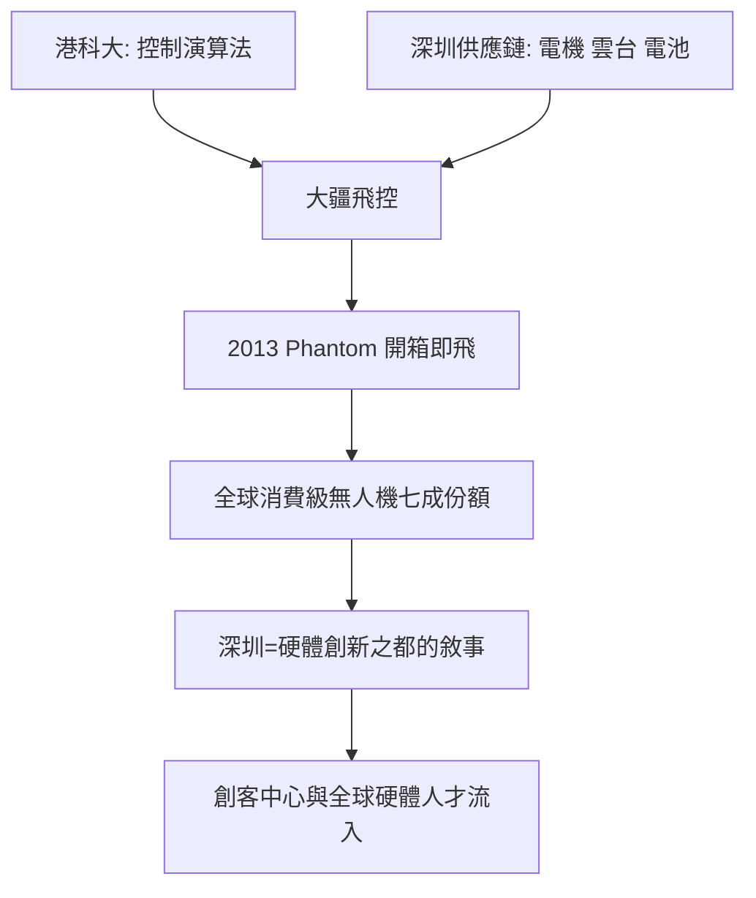

# 4.3 大疆與無人機：硬體創新的範式

2006年，香港科技大學畢業生汪滔在深圳創立大疆創新，最初只是在車庫般的辦公室裡做飛行控制系統，客戶是少數航模玩家。2010年前後，大疆轉向一體化四旋翼飛行器，2013年發布Phantom精靈系列，「開箱即飛」把專業航模變成大眾消費品，公司收入連年翻倍，數年間占據全球消級無人機市場約七成份額。大疆的崛起成為「深圳創新」最有說服力的樣本。

大疆的配方可以被拆解：頂層是香港高校的演算法與控制技術，中層是深圳的精密製造與供應鏈——電機、電調、雲台、電池、複合材料在華強北與珠三角一小時車程內全部可得，底層是熱愛飛行的工程師文化。三者缺一，都不會有消費級無人機這個品類。同時期，深圳還湧現出優必選的機器人、柔宇的柔性顯示嘗試、一加與榮耀的手機品牌，以及遍布南山科技園的智能硬體創業公司；HAX等硬件加速器把矽谷的創客項目拉到深圳打樣，「要去深圳做硬體」成為全球創客圈的共識。

2015年，深圳提出打造「國際創客中心」，柴火創客空間、賽格眾創空間等平臺密集出現。

## 因果分析

大疆案例的因果啟示在於：深圳的比較優勢不是原創科學，而是「技術—供應鏈—市場」的極速耦合。香港輸出知識（港科大），深圳輸出工程化與量產（供應鏈），全球市場輸出需求（航拍），三段因果環環相扣。華強北的元器件現貨使硬體試錯周期以「天」而非「月」計，這種迭代速度構成護城河——競爭者可以抄設計，卻無法在別處複製這套生態。大疆之後，深圳完成了敘事的自我強化：成功案例吸引資本與人才，人才與資本又催生下一批案例。從山寨到創新的轉型，至此不僅是政策口號，而是被一個品類的全球統治地位所證明。

$$
T_{\text{試錯}}^{\text{深圳}} \ll T_{\text{試錯}}^{\text{其他}}
$$

試錯周期的量級差距，就是硬體創新生態最本質的稀缺資源。

