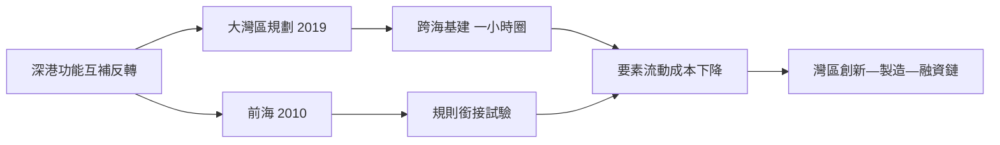

# 5.1 前海與粵港澳大灣區

2010年，國務院批復《前海深港現代服務業合作區總體發展規劃》，在南山半島西側的填海土地上劃出15平方公里，定位為深港合作與服務業開放的試驗區，推行比特區更特的政策：跨境人民幣貸款、港資企業所得稅優惠、法律適用香港法的嘗試等。前海的使命明確指向深圳的短板——金融、法律、專業服務等現代服務業，而這正是香港的長項。

2019年2月，中共中央、國務院印發《粵港澳大灣區發展規劃綱要》，將香港、澳門與廣州、深圳等九市納入一體化框架，明確深圳為「經濟特區、全國性經濟中心城市和國際化城市」，並在2023年前後以前海、河套等平臺深化深港規則銜接。港珠澳大橋（2018年通車）、廣深港高鐵（2018年）、深中通道（2024年通車）把灣區通勤時間壓縮到一小時量級；「灣區標準」「灣區社保互認」「港人港稅」等軟件逐步鋪開。

大灣區的經濟邏輯是城市間的功能互補：香港的國際金融與法治、深圳的硬體與科技製造、東莞惠州的先進製造、廣州的商貿與汽車，構成一條完整的創新—製造—融資鏈條。深圳GDP在2017年前後超過廣州、2018年超過香港（以人民幣計），由追趕者變為灣區引擎之一。

## 因果分析

前海與大灣區的因果起點，是深圳與香港彼此需要的結構反轉。1980年代是深圳需要香港的資本與訂單；四十年後，香港需要深圳的產業腹地與科技增長，深圳需要香港的金融深度與國際規則，互補關係成為一體化的動力。前海之於深圳，類似蛇口之於特區——再一次以小面積制度試驗撬動大格局，可見「試驗場」方法論已成為這座城市的路徑依賴。灣區基建則把制度合作物理化：一小時生活圈使人才、資本、數據的流動成本驟降，讓「跨境」逐漸失去摩擦。深港關係從「前店後廠」演變為「雙城共構」，深圳完成了從學生到合夥人的身份轉換。

