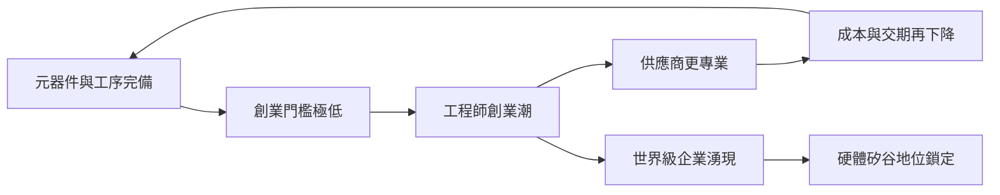

# 5.2 硬體矽谷：供應鏈的護城河

到2010年代末，深圳被全球科技媒體普遍稱為「硬體矽谷」。這座城市擁有華為、騰訊、大疆、比亞迪、中興、傳音、匯頂、欣旺達等一批世界級企業，南山區以不到全市十分之一的面積貢獻了約四分之一的GDP；全球新消費電子產品的樣機，多數仍要在深圳完成打樣與量產。與矽谷相比，深圳的獨特性不在於前沿研究或資本市場，而在於供應鏈本身：一部智慧手機所需的近兩千個元器件與工序，可以在深圳及周邊一小時車程內配齊。

供應鏈優勢的結構可以概括為三層：物理層是元器件現貨市場與模具、表面處理、組裝的完備工序網；組織層是數以萬計、互相咬合的中小供應商，可隨時拼裝成臨時生產網絡；資訊層是華強北與產業社群中高速流動的行情與工程知識。這三層疊加，使硬體創業的最小可行產品(MVP)周期壓縮到矽谷的幾分之一。

2019年，中國以深圳為示範，宣布建設「中國特色社會主義先行示範區」，要求深圳到2025年建成「現代化國際化創新型城市」。深圳同時聚集了西麗湖國際科教城、鵬城實驗室、深圳技術大學等補短板的科教設施，試圖修復長期以來「大學少、基礎研究弱」的先天缺陷。

## 因果分析

硬體矽谷的因果本質是「集聚的自我鎖定」。因為供應鏈完備，工程師創業容易；因為創業多，供應商更專業；專業化又進一步降低成本與交期——這是一個規模報酬遞增的循環，一旦形成便極難被外部複製。深圳在基礎研究上的短板之所以未阻礙崛起，正是因為這一循環以工程化與迭代速度為核心，而非以科學原創為核心。先行示範區政策則是對既有實力的追認與加碼：中央需要一個非矽谷模式的中國樣本，深圳需要政策空間補齊大學與基礎研究，供需再次匹配。矽谷與深圳的分工逐漸顯影——矽谷定義產品，深圳定義量產與成本曲線。

$$
\text{集聚優勢} \sim e^{\lambda t}, \quad \lambda>0
$$

供應鏈網絡的優勢隨時間指數放大，這是後來者難以追趕的數學原因。

