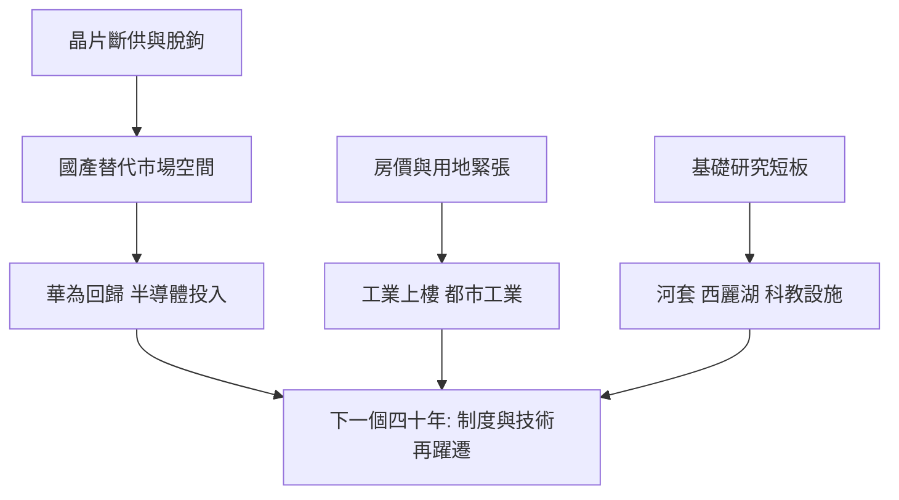

# 5.3 內卷、脫鉤與下一個四十年

深圳的第二個四十年，是在三重壓力下開場的。其一是地緣政治：2019年起華為被列入美國實體清單，先進晶片斷供，中興在2018年已被「斷芯」休克一次；出口管制與「脫鉤」威脅著以全球分工為前提的深圳模式。其二是成本與空間：房價高企、產業用地緊張，「逃離深圳」與製造業外遷東南亞的討論持續發酵。其三是內部挑戰：基礎研究與大學積累仍然薄弱，戶籍與住房對年輕人口的擠出效應顯現，人口增長在疫情後明顯放緩。

深圳的應對沿著因果邏輯展開：針對「卡脖子」，加大半導體與基礎研究投入，設立第三代半導體、合成生物等重大科學設施，推動河套深港科技創新合作區；針對成本，推動工業上樓與都市型工業，保住「工業基本盤」（深圳規上工業總產值多年居全國城市首位）；針對制度，以綜合改革試點授權清單（2020年）在要素市場化上繼續破題。華為則以鴻蒙系統與國產晶片手機的回歸，展示了極限壓力下的反彈能力。

四十年間，深圳人口從三十餘萬增長到近兩千萬，GDP從不足2億元躍升至3.4萬億元以上。這部城市傳記的核心情節從未改變：每一次危機——逃港、封鎖、泡沫、斷供——都被轉化為制度或技術躍遷的動力。

## 因果分析

下一階段的因果關係出現了性質變化。過去四十年的成功公式是「開放環境＋香港接口＋工程能力」，前提是全球化不可逆；而脫鉤打擊的正是這一前提，深圳被迫從「利用兩個市場」轉向「以內補外、以鏈防斷」。斷供的因果效應是雙向的：短期造成收入銳減與遷移壓力，長期卻為國產替代創造了原本不存在的市場空間——華為手機的回歸即是證明。房價的因果效應同樣雙向：它滋養了土地財政與創富效應，卻抬高創新的人力成本，可能侵蝕深圳賴以成功的「低成本試錯」根基。深圳能否再造一個四十年，取決於它能否像當年逃港危機催生特區那樣，把今天的壓力再次轉化為新的制度供給。

$$
G_{\text{深圳}} = \min\left(G_{\text{全球化紅利}},\ G_{\text{制度供給}}\right)
$$

開放紅利受限時，制度供給必須成為新的約束求解項。

