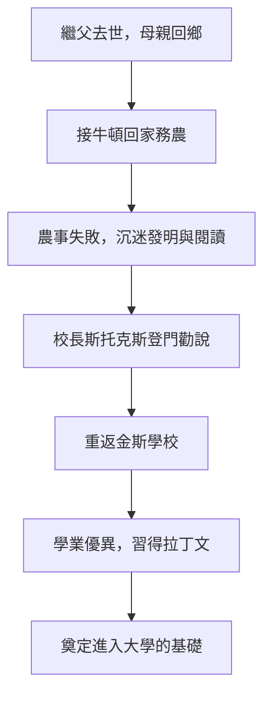

# 1.2 格蘭瑟姆的金斯學校

1653年，牛頓的繼父去世，母親帶著三個同母異父的弟妹回到沃爾索普。她做的第一件事不是讓牛頓回家團聚，而是把他從學校接回來，打算訓練他成為農夫，經營莊園。十三歲的牛頓被派去照顧羊群、看管磨坊，結果農事一團糟：羊群闖入鄰居的田地，他本人則躲在樹下看書、削木頭做模型。

學校的校長斯托克斯很快注意到這個學生的潛力，親自登門勸說漢娜讓孩子重返學校。斯托克斯甚至承諾減免學費。母親終於讓步——這是牛頓人生第一個關鍵的「貴人時刻」：如果沒有斯托克斯的堅持，英國可能多了一個蹩腳的農夫，而失去一位改寫科學史的巨人。

回到格蘭瑟姆的金斯學校後，牛頓寄宿在藥劑師克拉克家中。這段寄宿經歷對他有雙重影響：克拉克的化學藥品讓他接觸到煉金術式的實驗操作，日後他留下的大量煉金術手稿正源於此；而克拉克的繼女斯托勒小姐則成為他一生唯一的感情寄託，兩人晚年仍保持聯繫。在學校裡，牛頓因學業優異而嶄露頭角，他學會了拉丁文——當時歐洲學術的通用語言，這是他未來閱讀歐幾里得、笛卡兒著作的鑰匙。

## 因果分析

這一節的因果鏈條清晰可循：母親的功利打算（務農）與牛頓的天性（思考與製作）發生衝突，衝突的失敗結果（農事荒廢）反而成為證據，說服母親放棄計畫；校長的主動介入則把偶然轉化為機遇。金斯學校提供的拉丁文教育與藥劑師家的實驗環境，分別供給了牛頓未來理論（讀書）與實驗（動手）兩條腿。前因是環境的阻撓，後果是天賦的確認——這段「差點務農」的插曲，恰恰說明天才的誕生需要制度與個人的雙重配合。
