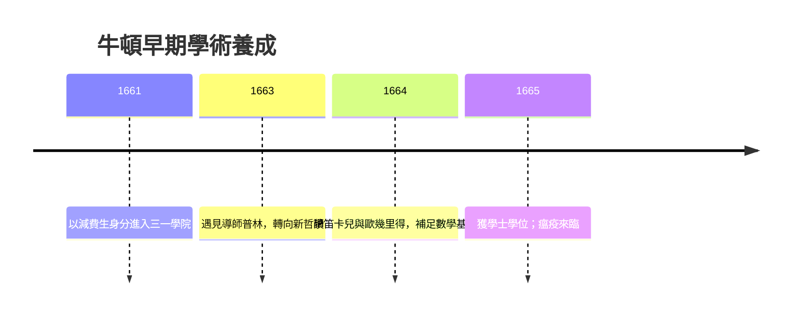

# 1.3 進入三一學院

1661年6月，牛頓以「減費生」（subsidizer）的身分進入劍橋大學三一學院。減費生是一種介於自費生與僕役之間的身分，需要為富家同學做雜務來抵扣學費——這再度提醒他自己的貧寒出身。當時的三一學院仍以亞里斯多德經院哲學為正式課程：邏輯、倫理學、修辭學與古典物理學。牛頓按照規定研讀亞里斯多德，但他很快在私人筆記中寫下「柏拉圖是我的朋友，亞里斯多德是我的朋友，但真理是我更大的朋友」。

真正改變牛頓命運的是導師本傑明．普林。普林原是劍橋的數學教授，因支持皇家學會的創立而被保守派排擠，轉任盧卡斯數學講座的第一任教授候選背景人物，並成為牛頓的導師。1663至1664年間，普林引導牛頓接觸笛卡兒的《幾何學》與《哲學原理》、伽利略的力學、以及當時剛剛傳入英格蘭的歐幾里得傳統。牛頓在1664年前後讀歐幾里得時嫌其太淺顯，改讀笛卡兒《幾何學》，卻發現自己幾乎每頁都遇到困難——這迫使他從基礎重新補足數學，最終在一兩年內趕上並超越了當時歐洲的數學水準。

1664年，牛頓獲得獎學金，經濟與學術地位同時穩固。1665年他取得學士學位。同年春天，歐洲迎來一場改變一切的大瘟疫。

## 因果分析

牛頓的劍橋起步揭示了一個重要的因果結構：經院課程（因）使牛頓不滿而自學新學（果），而導師普林的角色是把「自學的飢渴」導入正確的書單。笛卡兒《幾何學》的困難（前因）迫使牛頓重修歐幾里得與代數，補齊短板（後果），這種「先碰壁再築基」的路徑造就了他異常紮實的數學功力。此時的積累是純粹的「因」，它在1665年瘟疫隔離的特殊條件下，即將爆發為微積分、光學與引力三大成果——劍橋的輸入，是奇蹟年代的必要前提。
