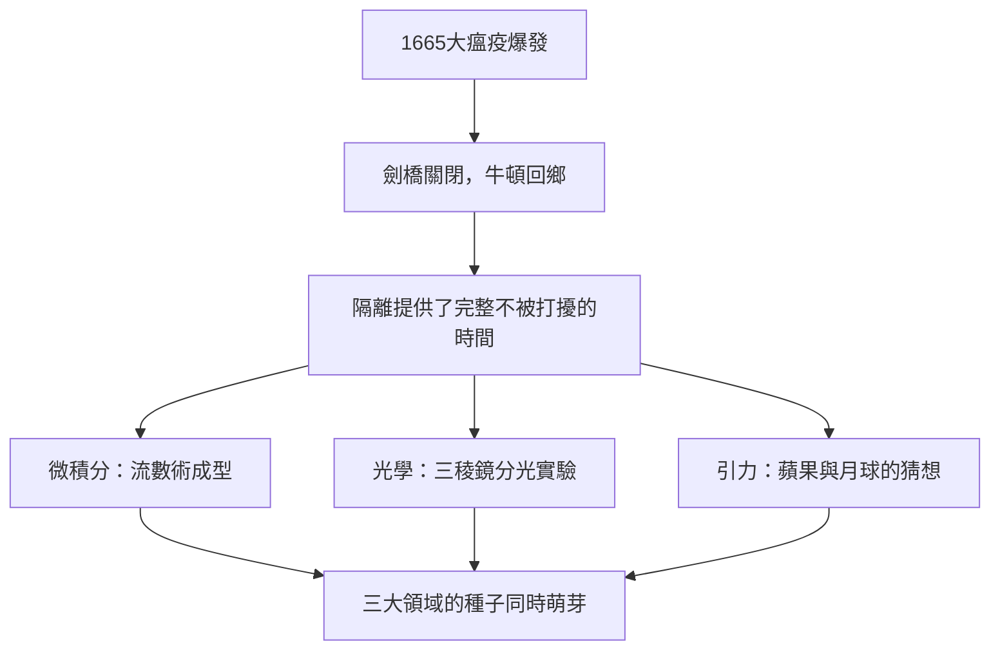

# 2.2 1665年大瘟疫與回鄉歲月

1665年夏，腺鼠疫從倫敦蔓延至劍橋，三一學院被迫關閉，牛頓回到沃爾索普老家。他在那裡度過了前後約十八個月的隔離時光（1665–1666，中間曾短暫返校）。這段時間後來被稱為「奇蹟年代」（annus mirabilis）——牛頓晚年在回憶中寫道：「因為當時我正處於發明的黃金時期，對數學與哲學的專注，超過此後的任何時光。」

在故鄉的果園裡，發生了那件著名（但被牛頓自己晚年誇飾）的「蘋果落地」事件。較可靠的版本來自牛頓友人斯圖克利與德穆瓦的記述：牛頓看到蘋果墜地，開始思考「重力能否延伸到月亮？」他隨即做了一次估算：若重力隨距離平方反比減弱，則月球軌道所需的向心力與地表重力應當吻合。他當時的計算大致符合（受地球半徑估計誤差影響，結果略有偏差），但牛頓並未立即發表，因為他對「球體能否視為質點」尚無嚴格證明。

同一時期，他完成了微積分的基本架構（流數術）、用三稜鏡實驗發現白光的複合性，並設計出第一個「牛頓環」觀察。一個人在十八個月內同時開創三個學科，這在科學史上空前絕後。

## 因果分析

瘟疫（因）與天才的積累（另一因）在此相遇，產生「奇蹟年代」之果。關鍵在於理解因果的方向：不是瘟疫造就了牛頓，而是牛頓此前的多年積累，在瘟疫提供的「意外自由」中被快速兌現。若無1664年的級數與力學準備，隔離只是無聊的鄉居；若無隔離，繁忙的學院生活可能永遠不會給他整塊的思考時間。此外，蘋果估算的「未完成」也極為重要——它遺留的球體積分問題，將在二十年後由微積分解決，並直接促成《原理》的寫作。前因是隔離，後果是三顆種子，中間的驅動力是積累與自由的乘積。
