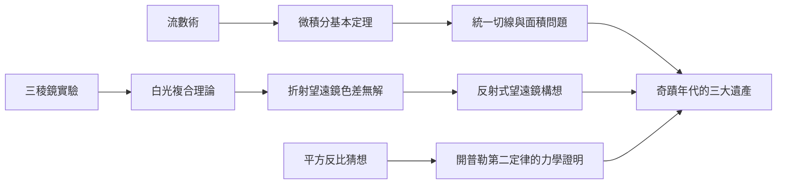

# 2.3 微積分、光學與萬有引力的萌芽

回到劍橋後，牛頓把瘟疫時期的成果系統化。1666年10月的《流數短論》是他第一篇完整的微積分手稿，其中明確區分了「正流數」（變化率，即微分）與「逆流數」（累積，即積分），並指出二者互為逆運算——這就是微積分基本定理的雛形：

$$\frac{d}{dx}\int_a^x f(t)\,dt = f(x)$$

有了這條定理，求切線與求面積不再是兩個孤立問題，而是一枚硬幣的兩面。牛頓用它處理曲率、極值、曲線長度與旋轉體體積，方法論上已完備。

光學方面，1666年他在市集買了一枚三稜鏡，做了決定性的實驗：讓一束陽光穿過三稜鏡，投射出拉長的彩色光帶；再用第二枚反向放置的三稜鏡把彩色光束重新合成白光。這證明白光不是「純粹的」，而是所有色光的複合；顏色是光的固有性質，而非玻璃對光的「修改」。這一結論直接推翻了笛卡兒與虎克的颜色理論，也立刻指出折射望遠鏡的色差（chromatic aberration）是原理性的、無法透過打磨鏡片解決——這個認識（因）將直接催生反射式望遠鏡（果）。

引力方面，開普勒三定律已在天文學家間流傳，但無人能從力學原理推導它們。牛頓在1666年的手稿中已能證明：若行星受到與距離平方成反比的力，則其軌道應服從開普勒第二定律（等面積定律）。

## 因果分析

這一節展示了牛頓式思維的因果特徵：把「現象」還原為「規律」，把「規律」還原為「數學結構」。三個領域內部又互相驅動：微積分為引力計算提供工具（球體積分），光學的色差結論為反射望遠鏡提供動機，而反射望遠鏡又將把他推向皇家學會與虎克的爭執。種子雖已萌芽，卻仍埋在土裡——牛頓的完美主義與保密性格（前因）使他遲遲不願公開（後果），這為下一章的優先權爭議埋下伏筆。
