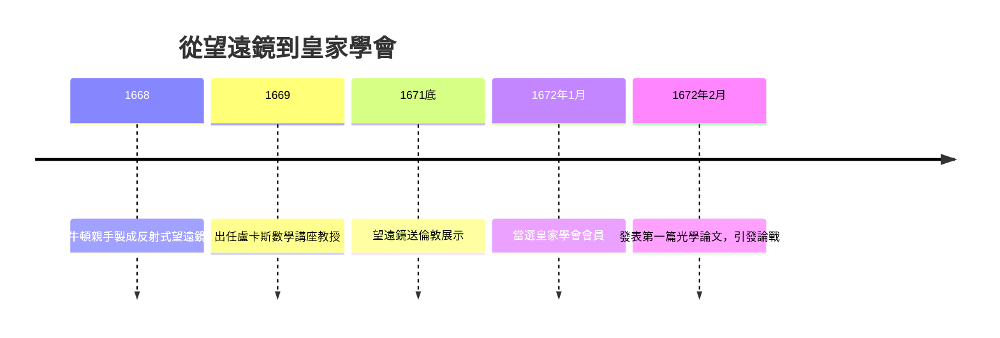

# 3.1 反射式望遠鏡與皇家學會

1669年，牛頓的老師巴羅（Isaac Barrow）主動讓賢，把盧卡斯數學講座教授職位讓給年僅二十六歲的牛頓。這是牛頓學術生涯的第一次公開確認。但牛頓在劍橋的前幾年仍幾乎不為外界所知，真正讓他嶄露頭角的是一件儀器——反射式望遠鏡。

因果鏈條很直接：牛頓的三稜鏡實驗證明白光由不同折射率的色光組成（前因），因此任何折射透鏡必然產生無法消除的色差（推論），於是他轉而設計用曲面鏡反射成像的望遠鏡，因為反射不分光（後果）。1668年他親手磨製鏡面，造出一台口徑約5公分、放大40倍的反射望遠鏡——它比同尺寸的折射鏡清晰得多，並在1671年底被送到倫敦，由國王查理二世與皇家學會觀看。

1672年1月，皇家學會選牛頓為會員。這是他第一次進入科學的公共舞台。幾乎同時，他在《哲學彙刊》上發表了第一篇公開論文：〈關於光與顏色的新理論〉。論文一鳴驚人，卻也掀起了他一生第一場公開爭論——批評者包括虎克、惠更斯與帕迪斯等人。虎克甚至寫了長篇批評，牛頓以近乎失禮的尖銳語氣回擊。

## 因果分析

這一節的因果是「實驗發現→技術發明→制度承認→公開衝突」的四段鏈：色差理論（科學發現）驅動反射望遠鏡（技術發明），望遠鏡的展示引來皇家學會（制度承認），而承認帶來的曝光立刻觸發與既有權威虎克的衝突。值得注意的是牛頓的個人特質如何介入因果：他的敏感與不容批評（性格前因）使一次正常的學術討論升級為個人恩怨（後果），他甚至一度威脅退出皇家學會。公開發表帶來的壓力，將在此後十餘年內反覆塑造他「寧可藏於抽屜，不願示於人前」的出版策略。
