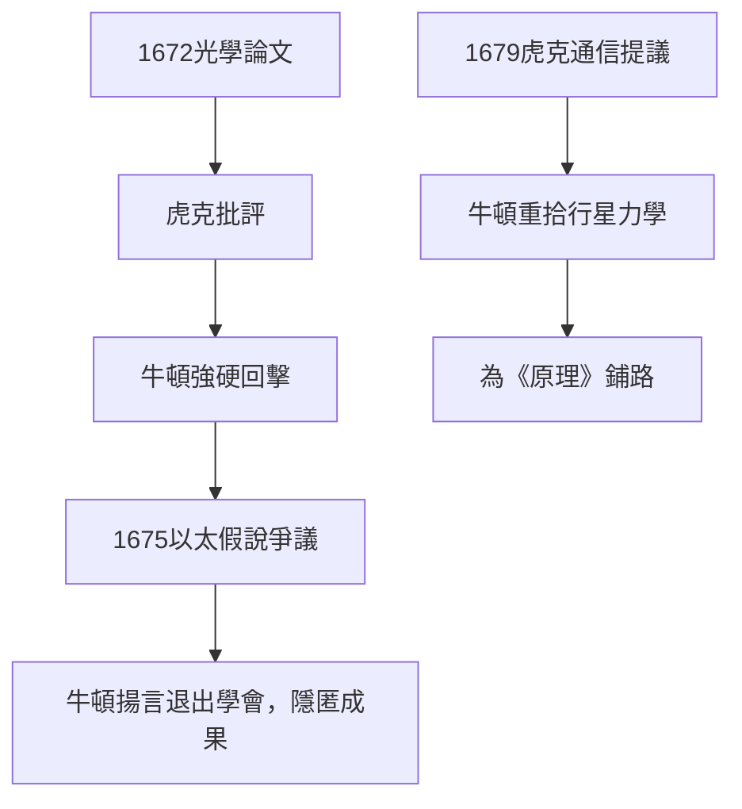

# 3.2 與虎克的爭執

羅伯特．虎克（Robert Hooke）是皇家學會的實驗室主管，比牛頓年長七歲，以顯微鏡研究《顯微圖譜》聞名，也是光的波動說倡導者。1672年牛頓的光學論文發表後，虎克在三小時內就讀完並提出批評：他認為牛頓的實驗固然精巧，但「顏色是光的固有屬性」這一結論只是多種可能解釋之一；他自己的「脈動說」同樣能解釋色彩。牛頓的回覆極為強硬，指責虎克傲慢而淺薄。

爭執在1675至1676年達到高潮。牛頓提交了《假說解釋光之性質》一文，其中包含「以太」振動的猜測；虎克隨即宣稱牛頓的許多觀念出自他的《顯微圖譜》。牛頓的反應是徹底撤回：他寫信給皇家學會祕書奧登伯格，表示厭倦於「被當作支持他人野心的工具」，並威脅退出學會。正是在1676年2月回覆虎克的一封信中，牛頓寫下了那句著名的話：

> 如果我看得更遠，那是因為站在巨人的肩上。

後世常把此句當作謙遜格言，但在語境中，它其實是對虎克的譏刺——暗指虎克並非他立足的巨人。

虎克與牛頓的另一個關鍵交集在引力問題。1679年虎克擔任學會祕書後主動寫信給牛頓，提議通信討論行星運動，並提出「力與距離平方成反比」的猜測以及「用曲線運動分解直線慣性與向心吸引」的思路。這次通信（前因）重新點燃了牛頓對行星力學的興趣（後果），成為日後《原理》的直接觸媒。

## 因果分析

這段關係的因果是雙向而弔詭的：負面方面，虎克的攻擊（因）使牛頓退回私人研究，延遲了光學與微積分的公開（果），也塑造了《原理》中「隻字不提虎克貢獻」的報復式沉默；正面方面，正是虎克1679年的通信（因）把牛頓從煉金術與神學研究中拉回力學（果），並提供了平方反比猜想與分解運動的方法論線索。因此虎克既是牛頓公開發表的最大阻礙，也是《原理》誕生的重要外因。科學進步未必依賴友善——有時敵手的刺激與盟友的協助同樣有效。
