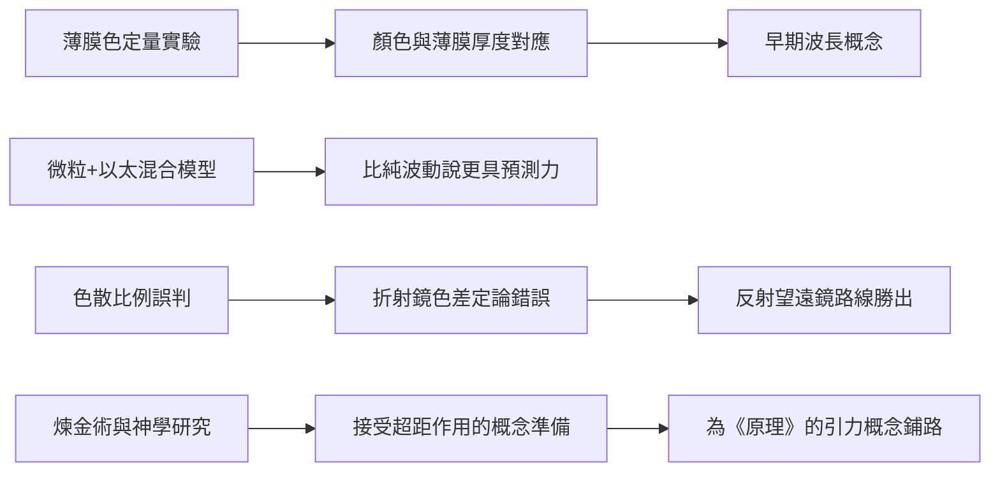

# 3.3 《光學》之前的色彩理論

從1672年論戰之後到1684年，牛頓的光學研究持續深化但鮮少公開。他在1675至1676年間撰寫的《色彩理論》（後世稱「Draft of a Theory of Colors」）手稿中，系統化了三稜鏡實驗群：臨界角實驗、色散測量、薄膜色（牛頓環）的定量觀察。他把薄膜色的明暗圈換算成空氣薄膜的厚度，試圖建立顏色與「光的質點大小或振動週期」之間的對應——這是後來波長概念的遠祖。

牛頓對光的本性採取了一種務實的「微粒—波動混合」立場：他偏好光是微小質點（corpuscles）的觀點，因為它能直接解釋直線傳播；但他同時引入「以太振動」來解釋薄膜干涉與繞射現象。這種折衷（因）使他的理論在當時比虎克的純波動說更有預測力（果），卻也讓後世讀者容易誤解他是武斷的微粒說者。

色散研究還有一個實用結論：牛頓測得不同玻璃的色散比例相近，因而錯誤地推論折射望遠鏡的色差在原理上不可消除（他不知道消色差透鏡的可能，該透鏡要到1733年才問世）。這一誤判（因）反而鞏固了反射式望遠鏡的正當性，也使英國在反射鏡製造技術上領先百年（果）。

1684年之前，牛頓的重心其實已大幅轉向煉金術與神學——他留下上百萬字的煉金實驗記錄與異端神學手稿。這段「分心」並非浪費：煉金術的「活性原理」思考，後來幫助他接受「超距作用」這一反笛卡兒的概念。

## 因果分析

這一節的核心因果是「錯誤也能推動進步」：牛頓關於色差不可消除的誤判，非但沒有阻礙，反而因為把資源導向反射鏡技術而加速了天文儀器的進步。同樣地，他隱匿光學成果近三十年（因），表面上延誤了科學傳播，實際上使《光學》在1704年出版時以成熟體系問世（果），影響反而更深。此外，煉金術對「粒子間作用力」的長期冥想，是他敢於提出萬有引力這種「神祕超距力」的心理準備——一位純粹的機械論者可能永遠寫不出《原理》。
