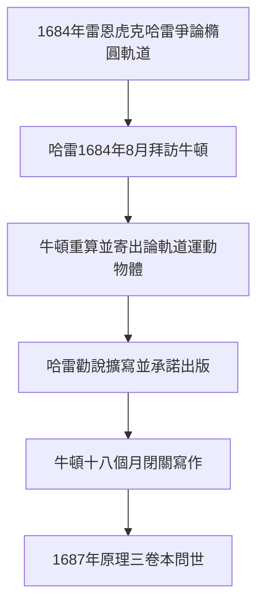

# 4.1 哈雷的造訪與三卷手稿

1684年1月，倫敦的一場咖啡館爭論改寫了科學史。建築師雷恩、虎克與年輕的天文學家哈雷爭論：若行星受平方反比力吸引，其軌道形狀為何？虎克聲稱自己已解出答案卻不肯示人。哈雷帶著疑問，在同年8月親赴劍橋拜訪牛頓。牛頓的回答令哈雷震驚：那必然是橢圓，他幾年前就算出來了，只是手稿不知塞到哪裡。哈雷追問之下，牛頓重新計算，並在三個月後寄給哈雷一篇九頁短文《論軌道運動物體》，其中已能從平方反比力推出開普勒三定律。

哈雷立刻意識到這篇短文的價值。他再度北上勸說牛頓擴寫，並承諾自費出版。牛頓被說服，進入長達十八個月近乎閉關的寫作期。他把奇蹟年代的流數術、1679年與虎克通信的運動分解法、以及球體引力定理熔於一爐，寫成三卷本《自然哲學的數學原理》。寫作期間他幾乎足不出戶，飲食無度，有時整夜在書房踱步推演命題。

## 因果分析

哈雷的造訪是典型的外部觸媒引爆內部積累。牛頓早已具備全部數學工具，卻因與虎克爭執後的厭世心態而不願發表；哈雷的追問、資金承諾與出版打理，恰好移除了發表鏈上的每一個障礙。沒有哈雷，《原理》可能永遠是抽屜裡的手稿；沒有牛頓二十年的積累，哈雷的問題也無人能答。前因是爭論與拜訪，後果是科學革命的總綱，而驅動力是積累與機遇的相乘。
