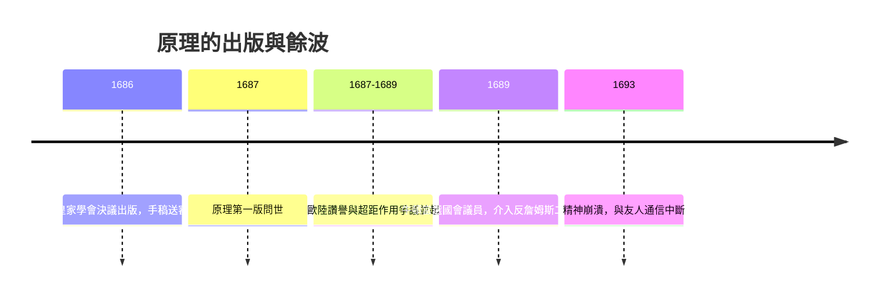

# 4.3 科學革命的高峰與代價

《原理》於1687年7月出版，初版約五百本，很快售罄。歐洲大陸的反響兩極：哈雷與洛克盛讚，惠更斯雖欽佩其數學卻拒絕接受超距作用，萊布尼茲學派則批評引力是神秘性質的復辟。牛頓預料到爭議，在第二版中加入著名的總釋，宣稱我不虛構假說，只從現象推出力，而力的原因留待後人。

成功的代價很快顯現。出版過程中牛頓與虎克就優先權爆發最後決裂：虎克要求在書中加註自己提出平方反比的貢獻，牛頓憤而威脅撤回第三卷，最終只在第一卷以一句冷淡的話帶過。此後牛頓與皇家學會的關係再度冷卻，他轉向神學年表與煉金實驗，並在1693年前後經歷一場精神崩潰，失眠、猜忌、食慾不振，與洛克、佩皮斯通信中流露被害妄想。現代學者推測原因包括長期汞中毒、過勞與孤獨的疊加。

## 因果分析

《原理》的出版同時是高峰與轉折點。聲望帶來論戰，論戰加劇牛頓的防衛與孤立，孤立又把他推向神學與煉金術的避難所，最終釀成精神危機，這是一條清晰的負反饋鏈。另一方面，1689年牛頓當選劍橋大學議員、參與光榮革命後的權力重組，卻為他打開了通往鑄幣局的政治之門。科學上的登頂意外地終結了他的純學術生涯，把他推向下一章的公共職位。前因是出版的榮耀與創傷，後果是學者牛頓的退場與官員牛頓的登場。
