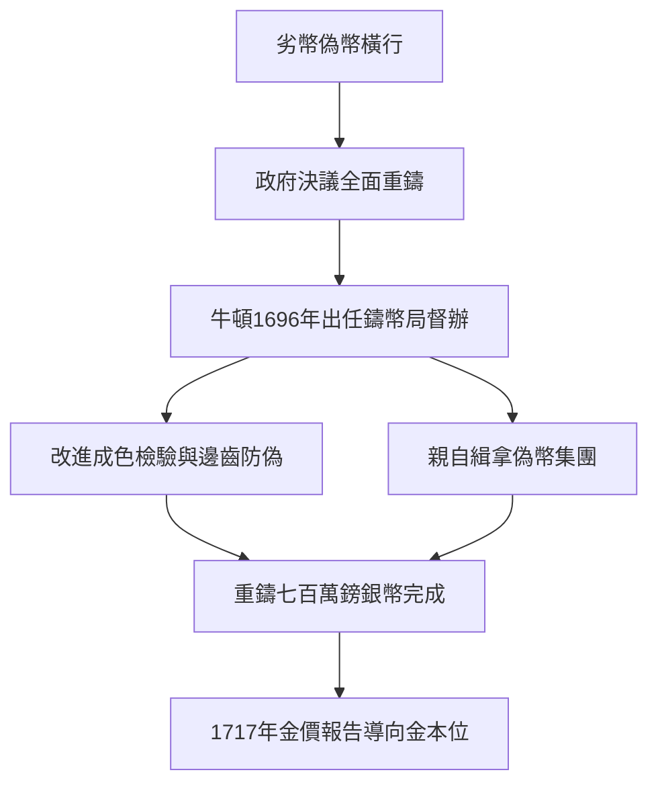

# 5.1 皇家鑄幣局的重鑄運動

1696年，在財政大臣蒙塔古的舉薦下，牛頓出任皇家鑄幣局督辦，三年後升為局長，年薪逾千鎊，遠超教授俸祿。這不是閒職：當時英國銀幣磨損與偽造猖獗，劣幣驅逐良幣，政府決定全數重鑄。牛頓以科學家的嚴謹投入行政，他親自 assay 金銀成色，改進沖壓與邊齒工藝以防剪邊，並建立偽幣檢舉與審判流程。

他對偽造者毫不寬容，親自喬裝調查倫敦地下錢莊，把偽幣大王查洛納送上絞刑架。據統計，他經手起訴的偽幣案逾百起。在技術層面，他主導大重鑄期間近七百萬鎊銀幣的重造，並在1717年提出金銀比價報告，建議以每金畿尼二十一先令定價，無意間把英國推向金本位。這份報告（前因）使白銀外流、黃金流入（後果），奠定了十八世紀英國的貨幣秩序。

## 因果分析

鑄幣局生涯是《原理》成功的政治果實：光榮革命後輝格黨掌權，蒙塔古需要可靠的學者官僚，牛頓需要脫離劍橋的孤寂與低薪，雙方需求互補促成任命。而牛頓把實驗室的精確帶入官僚體系，精確又反過來鞏固了他的權威，使他從書齋學者轉型為國家重臣。值得注意的是，化學與冶金知識本是煉金術研究的副產品，此時卻成為 assay 技術的直接資本，昔日的異端嗜好意外結出實用的果。
