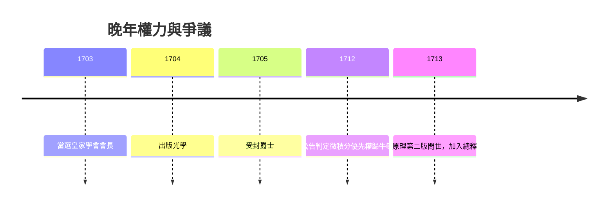

# 5.2 皇家學會會長與晚年

1703年虎克去世同年，牛頓當選皇家學會會長，此後連任二十四年直至逝世。他以鐵腕重塑學會：確立會報審稿制度，購置會舍，並把學會變成英國科學的最高仲裁者。1704年他出版醞釀三十年的《光學》，以英文寫成、附三十一條疑問作結，提出光微粒說與以太振動的綜合圖像，首版即售罄，多次再版。

會長任內最具爭議的是與萊布尼茲的微積分優先權之爭。1712年牛頓授意學會成立調查委員會，報告《公告》判定牛頓先發明而萊布尼茲抄襲，而報告實由牛頓匿名執筆。這場判決（前因）使英歐數學界分裂數十年，英國固守流數符號而落後於歐陸的微分符號（後果）。晚年的牛頓享有盛名：1705年受封爵士，皇室宴會座上賓，但私生活依然孤寂，終身未婚，與外甥女巴頓一家同住，由她照料起居。

## 因果分析

會長權力是早年受辱的補償機制：青年牛頓畏懼公開批評，晚年牛頓則掌握批評他人的制度機器。權力使他能推動《光學》與《原理》再版，鞏固學派，卻也使優先權之爭從學術辯論淪為權力審判。虎克去世移除最後的制衡（前因），牛頓隨即銷毀學會中虎克的肖像與部分文稿（後果），足見個人恩怨如何扭曲公共記憶。晚年的榮耀與專斷是一體兩面，皆源於同一性格底色。
