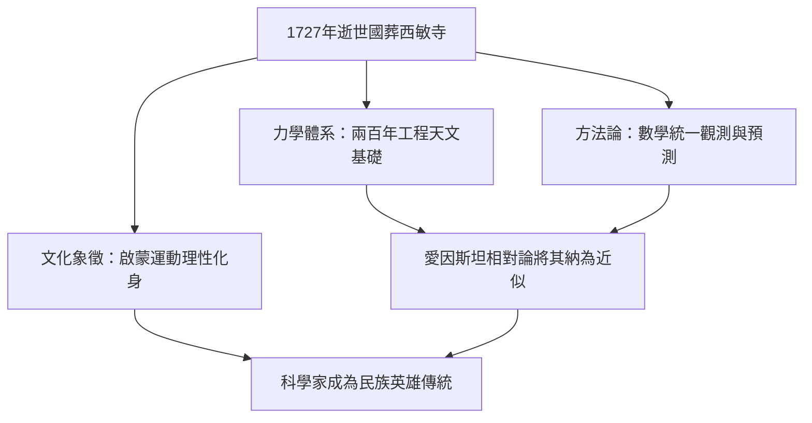

# 5.3 影響力與永恆的遺產

1727年3月31日，牛頓在倫敦肯辛頓逝世，享年八十四歲。遺體以國葬之禮安葬於西敏寺，送葬者包括貴族、學者與王室代表，墓誌銘稱他以幾乎神聖之力指出了行星的運行、白晝與黑夜的交替與海潮的秘密。這是英國史上第一次為科學家舉行國葬，標誌科學家正式躋身民族英雄之列。

牛頓的遺產可分為三層。第一層是力學體系： $F=ma$ 與 $F=G m_1 m_2/r^2$ 主宰工程與天文兩百年，直到愛因斯坦以 $E=mc^2$ 與廣義相對論將其納為低速弱場近似。第二層是方法論：以數學模型統一觀測、假說與預測的範式，成為此後一切理論物理的模板。第三層是文化象徵：啟蒙運動把牛頓塑造成理性戰勝蒙昧的化身，伏爾泰專程赴英宣揚，法國《百科全書》派奉之為先驅。

## 因果分析

牛頓的影響力並非單向輸出，而是多重因果的匯流：奇蹟年代的積累是內因，哈雷的出版資助是外因，鑄幣局與學會職位提供的社會地位是放大器，而啟蒙哲學家對其形象的再詮釋則是傳播器。反諷的是，牛頓本人篤信煉金術與異端神學、拒斥三位一體，這些卻被後世刻意淡化，理性英雄的形象恰是選擇性記憶的產物。從沃爾索普的孤兒到西敏寺的國葬，起點的匱乏與終點的榮耀首尾相連，證明個人創傷、制度機遇與時代思潮三者互相驅動，方能造就所謂的天才。
