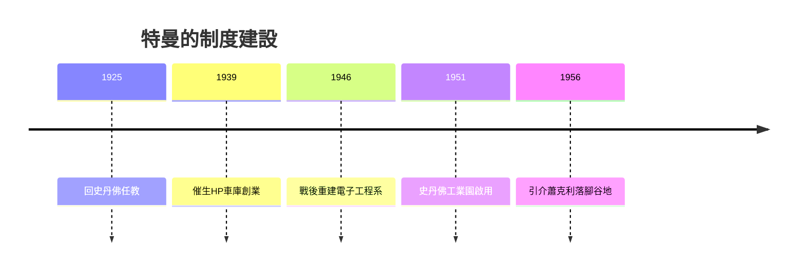

# 1.2 特曼與史丹佛工業園

弗雷德里克·特曼（Frederick Terman）常被稱為「矽谷之父」。他在MIT師從布什（Vannevar Bush），1935年回史丹佛任教後，立志把西岸的電子工業建立起來，讓優秀學生不必東移。他做了三件關鍵的事：第一，鼓勵HP與瓦里安（Varian）等學生或鄰人創業；第二，二戰後利用軍方合約把史丹佛電子工程系建成一流研究重鎮；第三，1951年主導設立史丹佛工業園（Stanford Industrial Park），把校有土地以長期租約出租給高科技公司——瓦里安、HP、洛克希德、GE相繼進駐。

特曼還推動「榮譽合作計畫」，讓本地工程師在職進修史丹佛課程，形成產學之間持續的人員與知識流動。這種「大學—產業—政府」三螺旋結構，比後來的創業理論早了半個世紀。

**因果分析**：特曼的洞見在於把土地、人才與制度轉化為聚集經濟。工業園使公司彼此鄰近，工程師在深夜酒吧交換情報，離職者能就近找到下一份工作或下一筆資金——地理密度放大了人才循環的速度。當1956年蕭克利決定創業時，正是特曼親自寫信遊說他把實驗室設在帕羅奧圖。沒有特曼的鋪路，矽谷的故事可能發生在別處。

