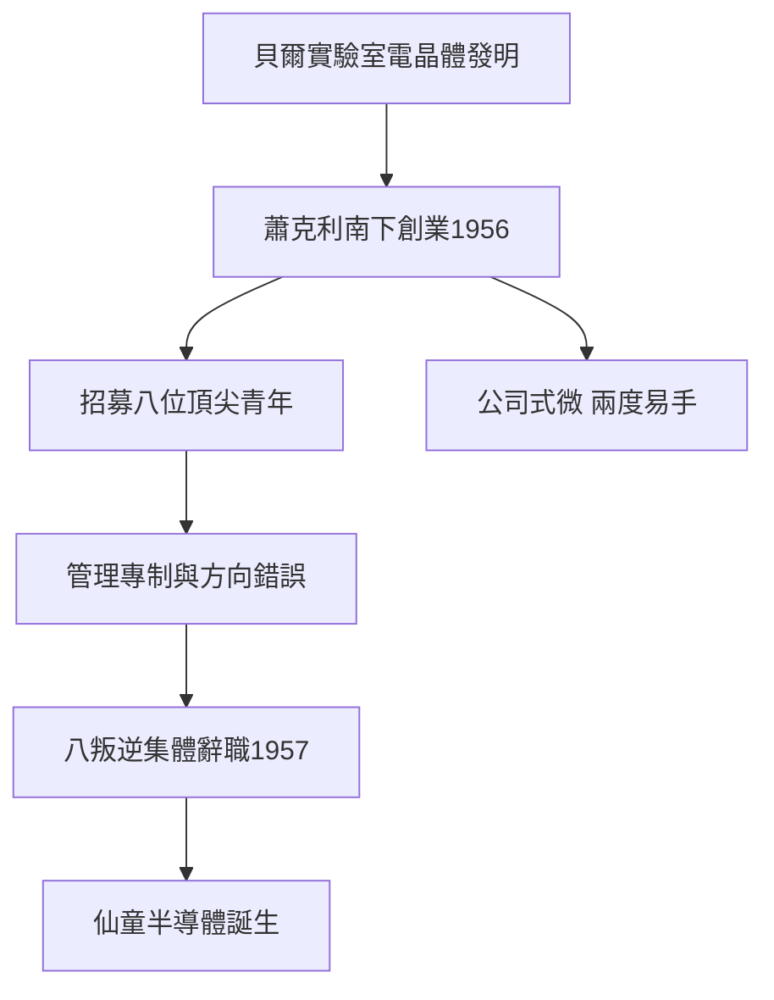

# 2.1 蕭克利半導體實驗室

威廉·蕭克利（William Shockley）是電晶體的共同發明人、貝爾實驗室的諾獎級人物。1955年他離開貝爾，受特曼遊說與加州情懷吸引，1956年在帕羅奧圖創立蕭克利半導體實驗室，投入矽電晶體（四層二極體）研發。貝爾體系的人脈加上矽材料路線，使這家小公司成為谷地從「電子」轉向「半導體」的起點。

蕭克利的招募廣告一出，應徵者雲集，包括後來的諾伊斯、摩爾等人。然而蕭克利是天才的科學家，卻是災難的管理者：多疑、獨斷，以測謊器檢視員工，否決團隊一致認定的積體電路方向，轉而執迷於自己的四層二極體。1957年，八位核心年輕工程師集體向投資人貝克曼（Arnold Beckman）請願撤換他未果，索性集體辭職。

**因果分析**：這是矽谷歷史第一次，也可能是最重要的一次「人才叛逃」。蕭克利的失敗管理製造了一個反教材：此後谷地的共識是「跟對人比跟對公司重要，股權比忠誠重要」。八叛逆出走直接催生仙童半導體；而蕭克利本人晚年轉向爭議性優生學主張，公司兩度轉賣終至消亡。若蕭克利善待他的團隊，仙童不會誕生，矽谷的系譜將完全改寫。

