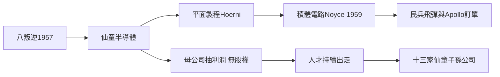

# 2.2 八叛逆與仙童半導體

1957年9月，諾伊斯（Robert Noyce）、摩爾（Gordon Moore）、格魯夫（Andrew Grove）、霍尼（Jean Hoerni）等八人簽署一份辭職書，被蕭克利怒斥為「八叛逆」（Traitorous Eight）。他們靠一通電話說服相機製造商仙童攝影器材公司的老板費爾柴爾德（Sherman Fairchild）出資138萬美元，成立仙童半導體，由諾伊斯任總經理。

仙童迅速成為西岸最重要的半導體公司：霍尼發明平面製程（planar process），使電晶體可以批量穩定製造；1959年諾伊斯基於平面製程做出積體電路，與德州儀器的基爾比（Jack Kilby）共享發明榮譽。1960年代仙童如日中天，利潤一度占母公司半壁江山。但母公司遠在紐約，把利潤抽走補貼相機業務，且不給子公司股票激勵。1968年，諾伊斯與摩爾再度出走，創立Intel；此前霍尼去了TELEDYNE，後創Intersil；其他諸多主管也各奔東西。

**因果分析**：八叛逆事件確立了矽谷的憲法——股權激勵、離職創業正當化、以及「公司只是人才的容器」。仙童的結構性缺陷（母公司吸血、無股權）成為後來所有創業公司設計員工期權制度的反面教材。平面製程＋積體電路兩項技術則是整個數位時代的物理基礎。仙童作為「公司孵化器」，其人才外溢本身就是矽谷最核心的成長機制。

