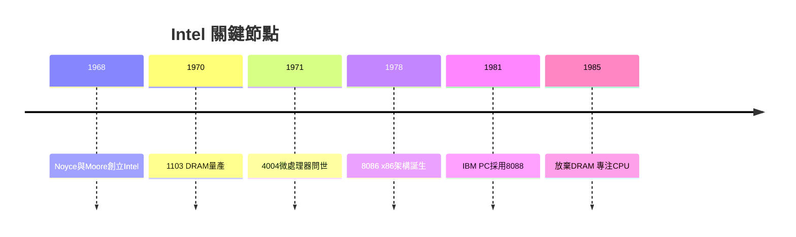

# 3.1 Intel與摩爾定律

1968年，諾伊斯與摩爾離開仙童創立英特爾（Intel），格魯夫隨後加入。公司一開始就聚焦半導體記憶體，1970年推出1103動態隨機存取記憶體（DRAM），取代磁芯記憶體，成為第一款量產的半導體記憶體。1971年，工程師霍夫（Ted Hoff）與費金（Federico Faggin）設計出4004微處理器——把一部電腦的中央處理器放進一顆晶片，這是資訊史上最關鍵的發明之一。1974年的8080成為早期個人電腦的心臟，1980年代IBM PC採用8088，x86架構從此統治桌面運算。

1965年摩爾提出觀察：晶片上電晶體數目約每兩年翻倍（後稱摩爾定律）。它不僅是技術預測，更被Intel轉化為商業策略：既然成本會指數下降，就必須搶先投資下一代製程，否則被淘汰。格魯夫1985年在DRAM被日本廠商擊潰後做出著名決斷——放棄記憶體，專注微處理器。

**因果分析**：Intel是仙童人才循環的直接果實，又成為新一代的果樹：費金離職創Zilog（Z80），格魯夫的管理哲學「唯偏執狂得以倖存」塑造了整個行業的競爭焦慮。摩爾定律提供了一個精確的節拍器，使整個生態的投資、創業與產品路線可以對齊同一條指數曲線——PC、網路、行動裝置的爆發，本質上都是這條曲線的下游。

