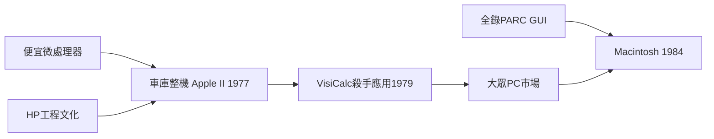

# 3.2 HP、Apple與個人電腦

惠普自1939年車庫起步，到1970年代已是測試儀器與計算機巨頭，其「惠普之道」（尊重員工、工程師文化、走動式管理）成為矽谷企業文化的原型，也用開放式實驗室氛圍滋養了整片谷地。但把PC革命引爆的是另一個車庫：1976年，兩位史帝夫——賈伯斯與沃茲尼克——在洛斯阿圖的車庫裡推出Apple I；沃茲尼克的工程天賦（他自稱受惠於惠普的工程文化）與賈伯斯的產品直覺結合，1977年的Apple II內建彩色圖形與軟碟機，成為第一部大眾化的個人電腦。

Apple II的成功仰賴生態：VisiCalc試算表1979年登場，讓小企業第一次有「必須買一台」的理由；Intel 6502等便宜微處理器則使硬體成本降到個人可負擔。1984年Macintosh把全錄PARC的圖形介面帶給大眾。同一時期，IBM PC（1981）採用開放架構與微軟授權的DOS，兼容機產業隨之爆發，PC進入千家萬戶。

**因果分析**：微處理器（上游：Intel/Zilog/MOS）→ 整機創業（Apple等）→ 殺手級應用（VisiCalc、文書處理）→ 大眾市場，這條鏈條展示了生態系各層互相驅動：沒有便宜晶片就沒有車庫整機，沒有殺手應用就沒有規模市場，而規模市場又回頭餵養晶片投資。賈伯斯1976年向Atari與雅達利時代的人脈、1979年參觀PARC，皆顯示人才與知識的流動仍是革命的核心燃料。

