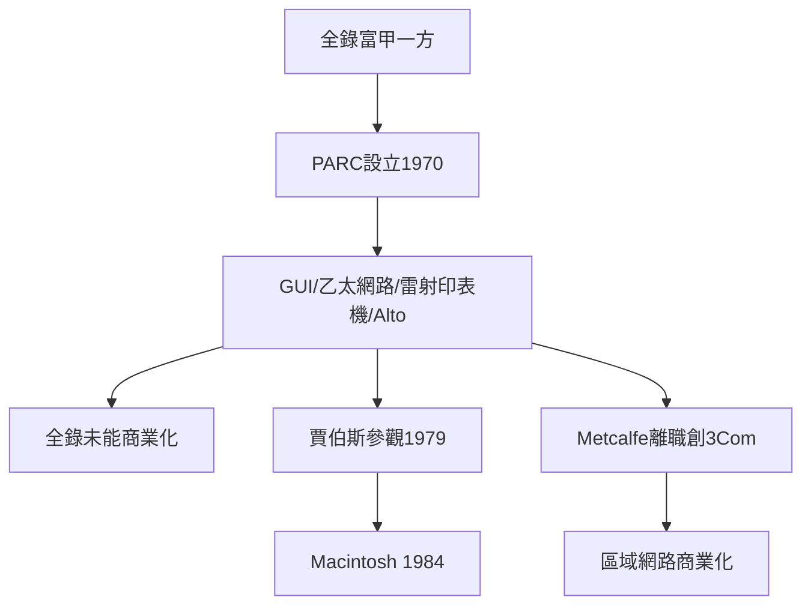

# 3.3 全錄PARC、軟體與生態成型

1970年，全錄（Xerox）在帕羅奧圖設立帕羅奧圖研究中心（PARC），網羅了一批頂尖電腦科學家。PARC在1970年代幾乎發明了現代計算的一切：乙太網路（Metcalfe與Boggs）、雷射印表機、圖形使用者介面（GUI）、滑鼠驅動的WIMP介面、所見即所得編輯、物件導向語言Smalltalk，以及Alto——第一台真正意義上的個人電腦。但全錄總部位於東岸，管理層看不見這些發明的商用價值，「在自家後院挖到了未來卻不知何用」。

1979年賈伯斯獲邀參觀PARC，看到GUI後大為震撼，回到Apple開發Lisa與Macintosh。Metcalfe則離職創立3Com，把乙太網路商業化，為區域網路時代鋪路。同時軟體業成型：微軟雖在西雅圖，但微處理器軟體生態（DOS、BASIC、應用軟體）與矽谷硬體深度咬合；甲骨文（Oracle, 1977）在谷地開拓關聯式資料庫市場。到1980年代末，矽谷已形成晶片—整機—網路—軟體—資料庫的完整堆疊。

**因果分析**：PARC的故事展示了矽谷因果線的兩面：一方面，人才聚集與寬鬆研究氛圍能爆發性地產出發明；另一方面，發明能否變成革命，取決於它是否落入能執行的創業者手中。PARC的成果經由「參觀—離職—創業」兩條管道外溢，直接催生Macintosh與3Com，印證了叛徒文化的進階版本——連別人的研究員都會成為你的革命火種。

