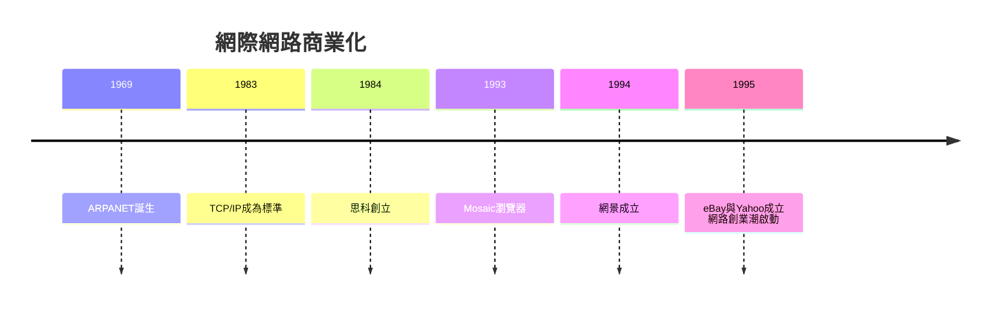

# 4.1 思科、網景與網際網路商業化

網際網路的前身ARPANET自1969年由國防部資助運行，長期限於學術與軍事圈。1980年代TCP/IP成為標準，大學與企業網路開始互連。史丹佛校園裡，一對夫妻檔工程師Leonard Bosack與Sandy Lerner為了讓不同系所的網路互通，開發出多協定路由器，1984年創立思科（Cisco），成為「網際網路的管路公司」。1990年思科上市後長期是市值最高的公司之一。

真正的引爆點是瀏覽器。1993年伊利諾大學NCSA的Mosaic讓網頁有了圖形介面；其作者安德森（Marc Andreessen）畢業後到矽谷，與SGI創辦人克拉克（Jim Clark）合作，1994年成立網景（Netscape），推出Navigator瀏覽器，上市首日股價暴漲——這是「網路時代的Apple II時刻」。微軟以IE迎擊，引發瀏覽器大戰；但更重要的是，網景證明了「純粹的網路公司」可以瞬間獲得巨大估值，全球創業家與資本蜂擁而入。亞馬遜（1994，雖在西雅圖）、eBay（1995，聖荷西）、Yahoo（1994，史丹佛學生創業）相繼出現。

**因果分析**：國防研究（ARPANET）→ 學術網路 → 校園裡的業餘發明（思科）→ 瀏覽器把網路變成大眾媒介。每一環都是前一環的果、後一環的因。網景的IPO則是心理轉折點：它把「網路」從工程師話題變成全民賭桌，直接點燃了第四章後半的泡沫。

