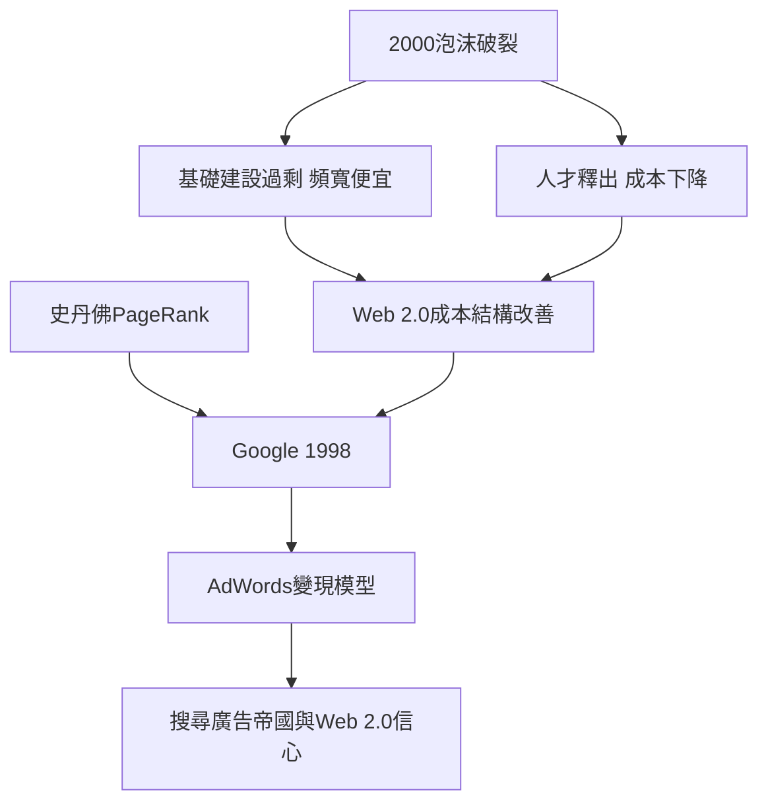

# 4.3 網路泡沫與Google的崛起

2000年3月，納斯達克見頂後崩跌，一年內市值蒸發逾五兆美元。Webvan破產、Pets.com倒閉、網景早已被微軟擊敗併入AOL，數千家公司消失，矽谷失業率一度接近8%。但崩盤同時是洗牌：倖存者專注現金流，工程師從倒閉公司流入新創企業，房屋與人才成本下降。

正是在廢墟上，Google證明了網路的真正價值。佩吉（Larry Page）與布林（Sergey Brin）1998年在史丹佛宿舍創業，核心是PageRank：以連結結構為網頁排序，把Web當成一個巨大的引用網路來計算權威度——這正是他們的學術背景與搜尋問題的完美耦合。1999年KPCB與紅杉聯手投資2,500萬美元；2000年推出關鍵字廣告AdWords，把搜尋意圖直接變成現金流；2004年上市，市值230億美元，宣告Web 2.0時代來臨。同一時期，YouTube（2005）、Facebook（2004，雖創於哈佛但很快移師帕羅奧圖）開始把「用戶生成內容」與「社交圖譜」變成新的平台邏輯。

**因果分析**：泡沫的崩潰清除了投機者，卻保留並擴散了基礎設施（頻寬、開源工具、搜尋引擎優化的人才庫）。Google的崛起說明了矽谷的深層韌性：它不是靠泡沫存活，而是因為泡沫鋪好了軌道——便宜的頻寬、免費的開源軟體、急於再起的創投，加上史丹佛與全錄系一脈相承的學術式創業傳統。每一次崩盤都為下一次浪潮降低了成本。

