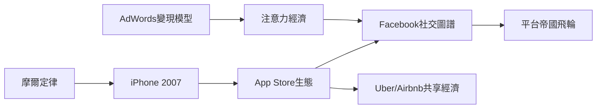

# 5.1 社交網路與行動平台

2004年之後，矽谷的主軸從「把既有內容上網」轉向「把人際關係與移動裝置變成平台」。Facebook由祖克柏（Mark Zuckerberg）創於哈佛，2004年搬到帕羅奧圖，以校園社交網路起家，憑藉「實名制＋社交圖譜」逐步擴張，2012年上市。同期Twitter、LinkedIn（2003，山景城）相繼出現，社交網路把注意力經濟制度化：用戶免費生產內容，平台以精準廣告變現——這條商業模式直接繼承自Google的AdWords邏輯，但把數據從「搜尋意圖」升級為「人格畫像」。

更具結構性的是行動革命。2007年賈伯斯發布iPhone，把電話、電腦與網路合為一體；2008年App Store上線，創造了全新的應用生態與分發管道。Uber（2009）、Airbnb（2008）等共享經濟公司藉手機的定位與支付能力重構實體服務；Instagram（2010）、WhatsApp（2009）以小團隊博得十億級用戶，最終被Facebook收購。矽谷的創業週期從「需要一棟樓」壓縮到「需要一台MacBook」。

**因果分析**：iPhone不是憑空出現——它是摩爾定律在行動晶片上的果實，也是全錄PARC以來GUI互動範式的集大成。行動平台反過來重塑社交網路：從桌面時代的「登入社交」變成隨身攜帶的「永遠在線」，數據量與廣告變現能力指數增長。平台帝國的飛輪由此咬合：更多用戶→更多數據→更好的演算法→更強的吸引力。這個飛輪也埋下了日後壟斷、隱私與政治極化的種子。

