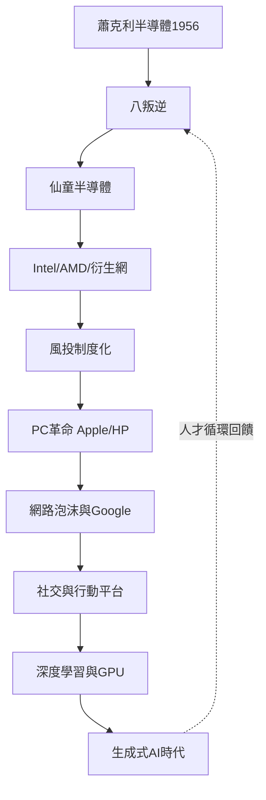

# 5.3 生成式AI與矽谷的當下

2022年11月，OpenAI的ChatGPT上線，兩個月內用戶破億，是史上最快的消費級應用。生成式AI瞬間成為矽谷的新主軸：微軟注資OpenAI並將GPT嵌入全線產品，Google以Gemini應戰，Anthropic（2021年由OpenAI前員工創立——又一次「叛徒」分拆）、Mistral、xAI相繼成立。NVIDIA市值在2023年突破一兆美元，2024年一度超越Apple成為全球之冠，H100晶片成為新時代的「民兵飛彈訂單」——各國政府與巨頭的算力採購支撐著整條供應鏈。

基礎設施投資的規模回到當年鐵路與光纖的量級：微軟、Google、Meta每年資本支出數百億美元興建資料中心，電力成為新瓶頸。創投資金再度高度集中於AI賽道，泡沫之問重新浮現：若大模型的邊際報酬遞減，是否重演2000年？樂觀者則指出，與.com泡沫不同，本輪的買主是能自我消化產能的巨型公司。

**因果分析**：回望全書，矽谷的每一次浪潮都循著同一條因果線：舊公司的管理僵局或技術路線分歧→人才出走→新公司與新範式→財富與知識再投資→下一波浪潮的種子。從蕭克利到八叛逆，從仙童到Intel與AMD，從全錄PARC到Apple與3Com，從Google到OpenAI與Anthropic，「叛徒文化」不是醜聞，而是這個生態的新陳代謝機制。AI時代只是這條百年曲線的最新一段，而它的下一個分叉，或許正在某間車庫或某次憤而離職的會議裡成形。

