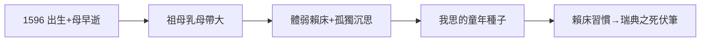

# 1.1 出生（1596）

1596 年 3 月 31 日，勒內·笛卡兒（René Descartes）出生於法國都蘭拉埃（今改名拉埃-笛卡兒）。母親生下他十三個月後去世，父親是布列塔尼議會議員，再娶。乳名「小哲學家」——體弱多病，家人沒指望他長壽。

## 孤兒式童年

- 母親早逝，父親遠任，由祖母和乳母帶大；
- 體弱：早上賴床的習慣被全家縱容——這個習慣保留一生（在瑞典早起上課要了他的命，見 5.1）；
- 孤獨：早年的孤獨養成沉思的習慣，「我思」的種子在童年。

## 與同時代人的對照

1596 年：莎士比亞 32 歲正寫《威尼斯商人》，伽利略 32 歲在帕多瓦教書，克卜勒 25 歲剛出版《宇宙的奧秘》。笛卡兒出生在科學革命的高潮——前輩搭台，他來唱戲。

**因果**：母死、體弱、孤獨——哲學家的標準童年。賴床的習慣看似小事，卻在 1650 年 2 月的斯德哥爾摩變成大事（5.2）。下一節，耶穌會學校。
