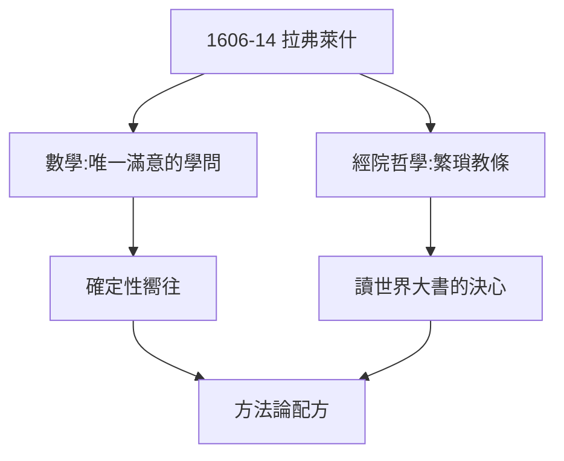

# 1.2 耶穌會學校（1606–1614）

## 拉弗萊什公學

1606 年入拉弗萊什耶穌會公學（歐洲最好的中學之一），八年：古典文學、經院哲學、數學。數學老師啟蒙了他對「確定性」的嚮往——「只有數學的證明讓我滿意，其他學問都是可疑的。」

## 畢業的幻滅

1614 年畢業時，他的結論是：**八年學問，除了數學，一無所得**。經院哲學的繁瑣區分、亞里士多德的教條，讓他立志：「不再讀書，讀世界這本大書。」——從軍、遊歷（1.3）的起點。

## 耶穌會的弔詭

- 他終身反經院哲學，卻終身感謝耶穌會的數學教育；
- 他後來的著作被教會列為禁書（1663），耶穌會卻一直以他為榮——愛恨交織；
- 確定性的種子（數學）+ 對教條的反感（經院）= 方法論（3.2）的全部配方。

**因果**：八年學校，兩樣收穫：愛數學，恨教條。下一節，讀世界——從軍。
