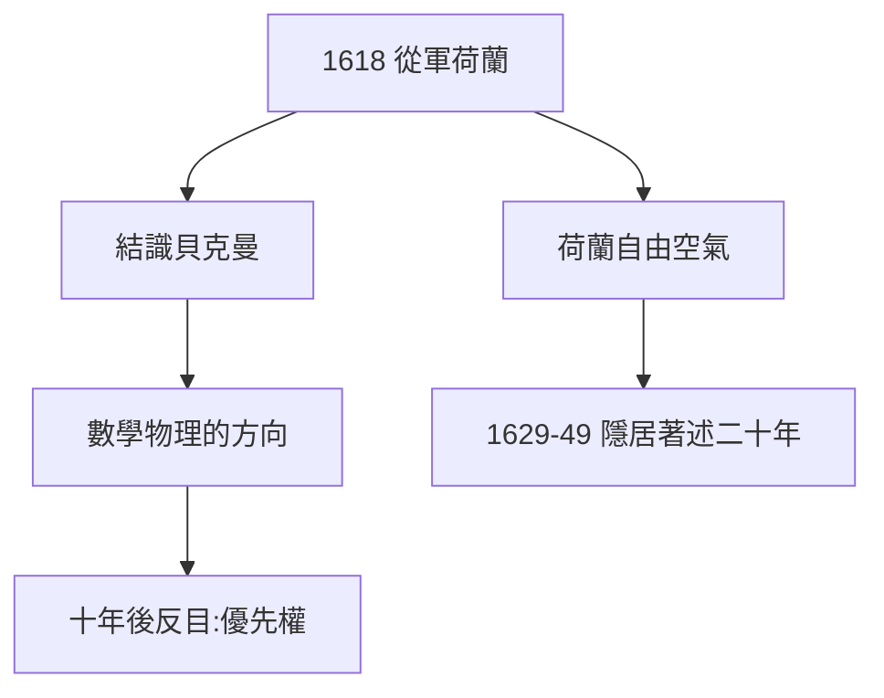

# 1.3 從軍與荷蘭（1618）

## 1618：拿起軍籍

畢業後學法律（1616 年獲普瓦捷大學法學位），但無心執業。1618 年加入荷蘭拿騷的莫里斯親王軍隊——名為從軍，實為遊學：三十年戰爭剛爆發，他 mostly 旁觀，結識了改變他的人：貝克曼（Isaac Beeckman）。

## 貝克曼：第一個伯樂

荷蘭物理學家貝克曼在佈雷達街頭用拉丁文懸賞數學難題，笛卡兒揭榜，兩人徹夜長談。貝克曼把他引向「數學物理」：用數學解釋自然——日記題獻「獻給貝克曼」。十年後兩人因優先權反目（貝克曼炫耀早年指導，笛卡兒絕交），但起點是真誠的。

## 荷蘭的自由

荷蘭是 17 世紀歐洲最自由的地方（出版自由、宗教寬容）。笛卡兒後來隱居荷蘭二十年（1629–49），著述全部在此完成——**自由是第一生產力**，荷蘭證明了這一點。

**因果**：讀世界（1.2 的決心）→ 從軍 → 貝克曼 → 數學物理。1618 年的街頭難題，是解析幾何的遠因。下一章，火爐之夢。
