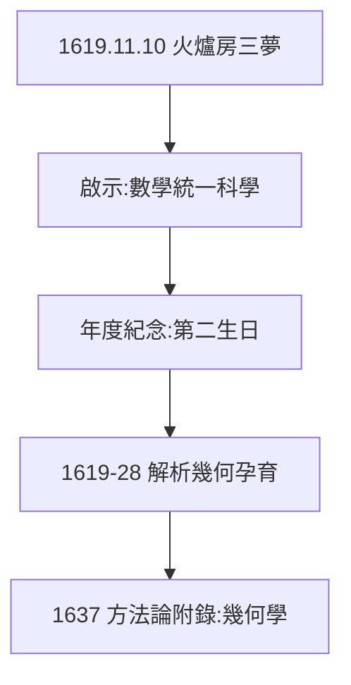

# 2.1 1619 年 11 月 10 日三夢（1619）

## 烏爾姆的火爐房

1619 年冬，笛卡兒在德國烏爾姆附近過冬，整天躲在燒得暖暖的火爐房（poêle）裡沉思。11 月 10 日夜，連做三夢：旋風、電光、百科全書（「什麼是人生之路？」）——醒來認定：上帝啟示他，**要用數學統一一切科學**。

## 夢的解讀

- 弗洛伊德式解讀：焦慮的投射；
- 笛卡兒式解讀：天啟；
- 史學解讀：長期思考的潛意識爆發（貝克曼的方向 + 數學的確定性，在夢中結晶）——「夢」是給自己下決心的儀式。

## 11 月 10 日的意義

笛卡兒把這天當作第二生日，此後每年紀念。科學史上罕見：一個夢，被當成研究綱領——而綱領真的兌現了（解析幾何，2.2）。

**因果**：貝克曼的方向（1.3）+ 確定性的嚮往（1.2）在夢中結晶。夢是藉口，決心是真的——下一節，九年的孕育。
