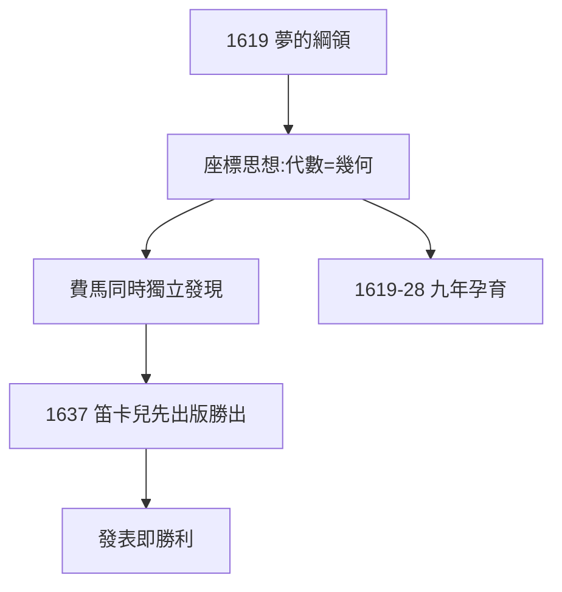

# 2.2 解析幾何的孕育（1619–1628）

## 座標的思想

核心突破：用代數方程表示幾何曲線——點對應數對 $(x, y)$ ，曲線對應方程 $f(x,y)=0$ 。傳說他躺在床上看天花板蒼蠅（賴床的副產品，1.1），想到用三個數定位蒼蠅——傳說雖不可靠，但「床上想座標」符合他的風格。

## 費馬的競爭

圖盧茲的費馬（業餘數學家，正職法官）同時獨立發現解析幾何，且先寫出手稿。兩人通過梅森（2.3）通信，互相不服——優先權之爭的常態。但笛卡兒 1637 年正式出版（《幾何學》），費馬的手稿 1679 年才刊行——**發表即勝利**。

## 九年磨一劍

1619–28 年，笛卡兒遊歷歐洲（德國、荷蘭、義大利、法國），思考、通信、寫作，就是不發表。1628 年定居荷蘭前，解析幾何已基本成熟——只等《方法論》的附錄（3.2）。

**因果**：火爐之夢（2.1）→ 九年孕育 → 1637 年出版。慢工出細活——而費馬的教訓是：再好的思想，不發表等於零。下一節，巴黎與梅森。
