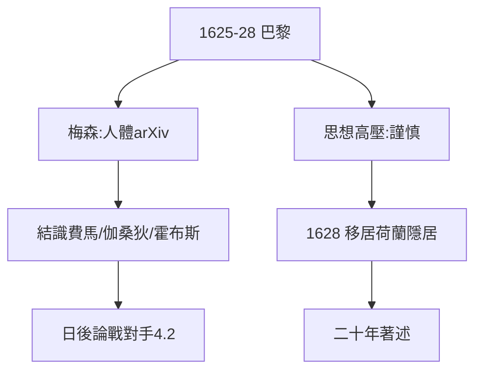

# 2.3 巴黎與梅森（1625–1628）

## 梅森：17 世紀的學術路由器

神父梅森（Marin Mersenne）是笛卡兒拉弗萊什的學長，巴黎學術圈的中心：所有人給他寫信，他轉發給所有人（沒有期刊時代的「人體 arXiv」）。笛卡兒 1625–28 年旅居巴黎期間，通過梅森與費馬、伽桑狄、霍布斯建立聯繫——後來的論戰對手（4.2），都是梅森介紹的。

## 巴黎的危險

1620 年代巴黎思想激進（自由思想者被燒死：瓦尼尼 1619 年圖盧茲火刑），笛卡兒小心翼翼：不公開無神論，只談方法。這種謹慎延續一生（3.1 的《世界》擱置）。

## 1628：移居荷蘭

1628 年，笛卡兒移居荷蘭，開始二十年隱居著述（換了 13 個住處，行蹤保密，連梅森都常找不到）。**巴黎給他網絡，荷蘭給他安靜**——兩者缺一不可。

**因果**：解析幾何的孕育（2.2）需要交流（梅森）也需要安靜（荷蘭）。1628 年的搬遷，是從輸入轉向輸出的轉折——下一章，《世界》與《方法》。
