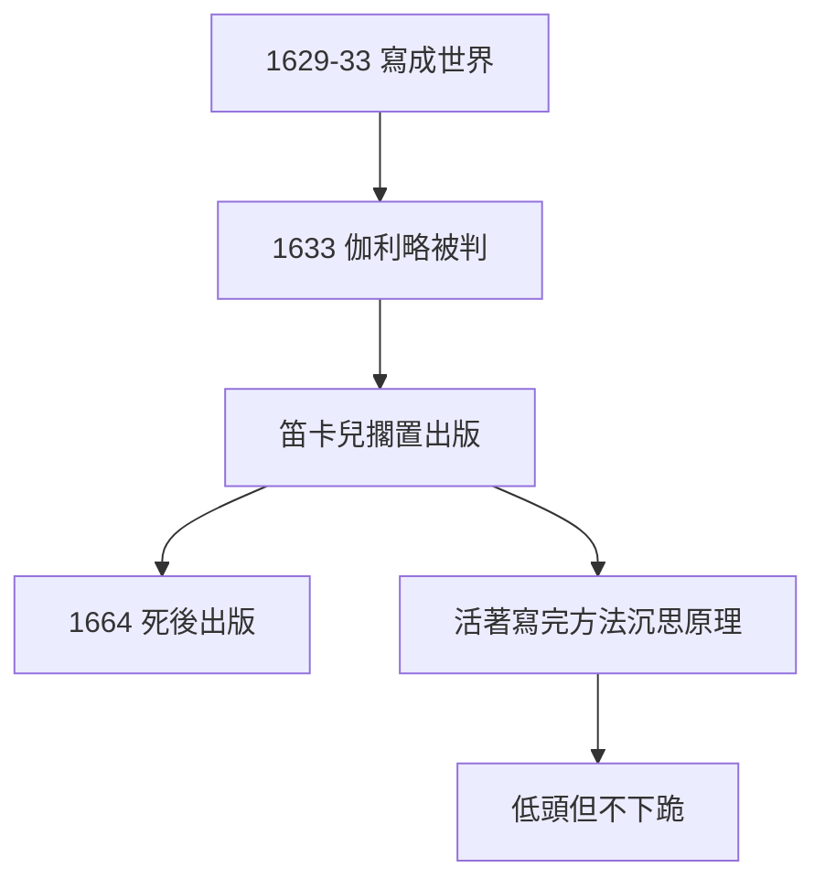

# 3.1 世界因伽利略案擱置（1633）

## 《世界》（Le Monde）

1629–33 年，笛卡兒寫成《世界》：哥白尼體系 + 渦旋宇宙論 + 機械論物理——第一部完整的近代物理體系。寫到出版前夜，消息傳來：1633 年伽利略被審判，地動說定罪。

## 擱置的決定

笛卡兒嚇壞了，立即擱置出版（「我寧可刪去一切，也不願發表一句教會不喜歡的話」）。《世界》1664 年死後才出版——**謹慎救了他的命，也耽誤了他的名**（渦旋說後來被牛頓批倒，部分原因是發表太晚、無人維護）。

## 恐懼的遺產

- 正面：活到 1650，寫完《方法》《沉思》《原理》——活著才有輸出；
- 反面：法國科學的保守化？不——他的書照樣傳播，只是晚了三十年；
- 對照伽利略：一個認罪（1633），一個擱置（1633）——**1633 年，科學向教會低頭，但沒有下跪**。

**因果**：巴黎的謹慎（2.3）在 1633 年兌現為擱置。擱置保住了命，也改變了寫作計劃——《方法論》（下一節）提前了。恐懼，有時是好的編輯。
