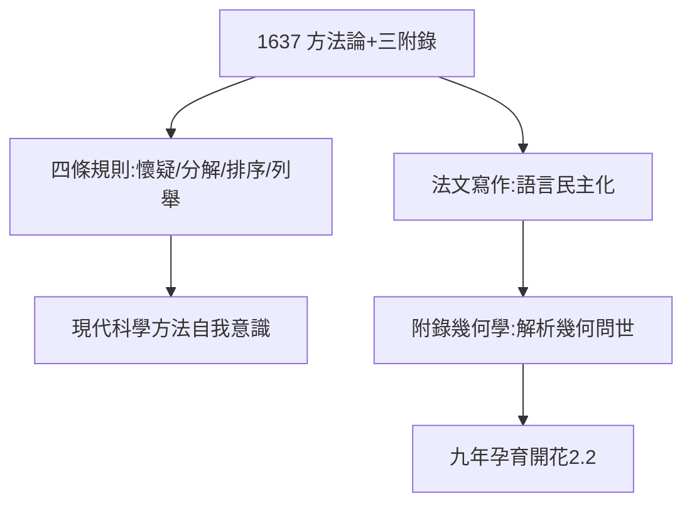

# 3.2 方法論（1637）

## 《談談方法》（Discours de la méthode）

1637 年，笛卡兒出版《方法論》（附三篇附錄：《屈光學》《氣象學》《幾何學》——解析幾何在此問世，2.2 的九年孕育開花）。正文提出四條規則：

1. **凡我沒有明確認識為真的，決不接受**（普遍懷疑）；
2. 把難題分成小份；
3. 從簡到繁依次思考；
4. 列舉周全，毫無遺漏。

## 法文寫作的革命

此前學術著作都用拉丁文，笛卡兒用**法文**寫作：「讓婦女和兒童都能讀懂」（實則讓不懂拉丁的法國人讀懂）。法文從此成為學術語言——語言民主化的里程碑（參照路德德文聖經）。

## 方法的悖論

他定的規則，自己並不全遵守（《沉思》的證明多有跳步）；但規則本身比遵守更重要——**現代科學方法的自我意識，始於這四條**。

**因果**：《世界》擱置（3.1）→ 方法論提前。恐懼的編輯是好編輯：1637 年的書比 1633 年的更安全、更深刻。下一節，書中最著名的一句話。
