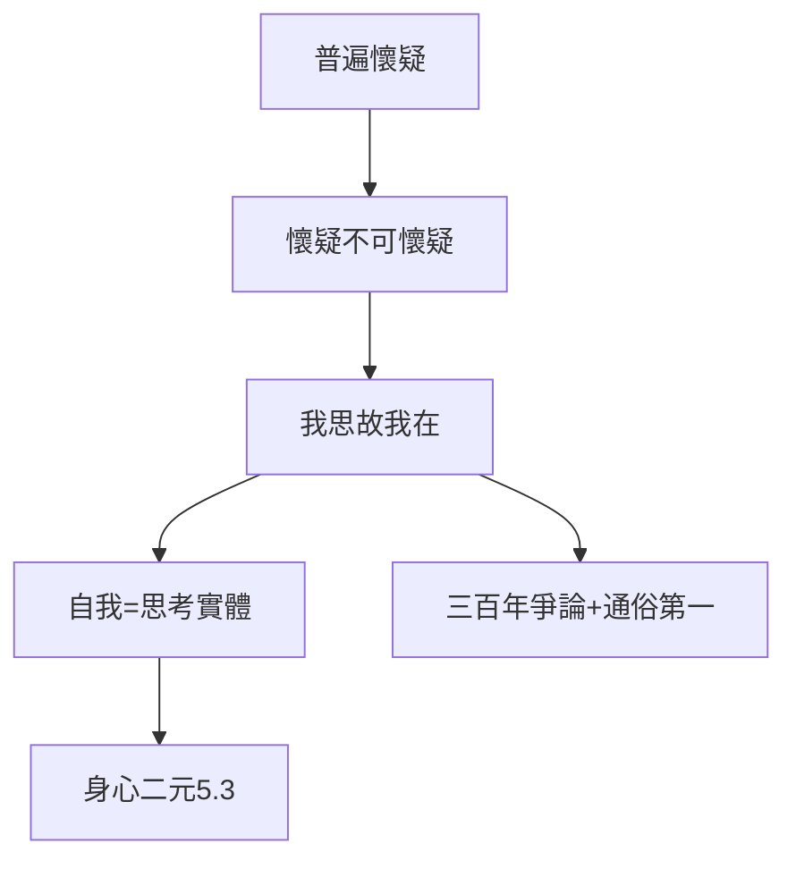

# 3.3 我思故我在（1637）

## Cogito, ergo sum

《方法論》第四部分：「我懷疑一切，但懷疑本身不可懷疑——**我思故我在**（Je pense, donc je suis）」。普遍懷疑的地基上，第一塊磐石：思考的自我。

## 三步推演

1. 懷疑一切（感官、數學、世界）；
2. 懷疑者存在（懷疑預設懷疑者）；
3. 自我 = 思考的實體（res cogitans），與廣延實體（res extensa，物質）二分——身心二元論的起點（見 5.3）。

## 三百年的迴響

- 支持：主體哲學的開端（康德、胡塞爾都從這裡出發）；
- 反對：循環論證？（用思考證明思考？）——三百年爭論不休；
- 通俗：印在 T 恤上的一句話，哲學史上傳播最廣的命題。

**因果**：拉弗萊什的確定性嚮往（1.2）→ 火爐之夢（2.1）→ 四條規則（3.2）→ 第一塊磐石。二十年的沉思，濃縮為五個拉丁詞。下一章，更系統的《沉思》。
