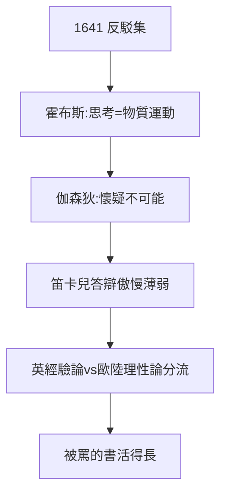

# 4.2 與霍布斯伽森狄論戰（1641–1644）

## 第二、三、四組反駁

梅森組織的反駁中，最狠的兩组：

- **霍布斯**（唯物論）：「思考只是物質運動，我思證明不了非物質自我」——一劍封喉；
- **伽森狄**（經驗論）：「普遍懷疑是不可能的，你 still 在用感官讀書寫字」——釜底抽薪。

笛卡兒的答辯傲慢而薄弱（罵伽森狄是「肉」，罵霍布斯是「不懂」）——**大師的弱點：只能接受讚美，不能接受反駁**。

## 論戰的價值

- 霍布斯的心物一元 vs 笛卡兒二元 → 英國經驗論 vs 歐陸理性論的分流；
- 伽森狄的原子論復活（伊壁鳩魯）→ 近代原子論的先聲；
- 被罵的書比被誇的書活得長——《沉思》因反駁而不朽。

## 貝克曼的陰影

1640 年代與貝克曼（1.3）徹底反目：貝克曼炫耀早年指導之功，笛卡兒翻臉絕交。伯樂變仇人——天才的感恩何其難。

**因果**：《沉思》（4.1）的出版策略（附反駁）養大了對手。霍布斯、伽森狄的刀，砍出了兩條路——笛卡兒的二元論從此不再孤獨，也不再安穩。下一節，《原理》。
