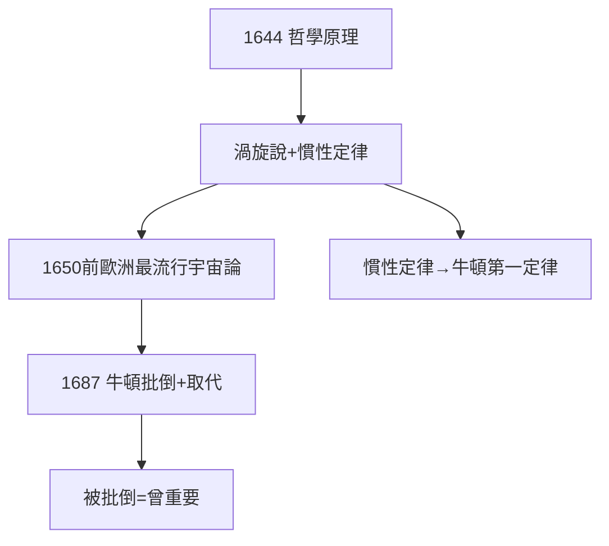

# 4.3 哲學原理與渦旋說（1644）

## 《哲學原理》（Principia Philosophiae，1644）

笛卡兒的集大成：從形而上學到物理學，提出**渦旋說**——宇宙充滿以太漩渦，行星被漩渦帶著轉。1650 年前，這是歐洲最流行的宇宙論（牛頓《原理》1687 年才取代它）。

## 渦旋的功與過

- 功：第一個機械論宇宙（無需天使推動行星），慣性定律的清晰表述（牛頓第一定律的直接來源）；
- 過：定量全錯，漩渦無法解釋克卜勒定律；
- 牛頓在《原理》中專門批渦旋說——**被批倒，說明曾重要**。

## 書名的野心

敢叫 *Principia*（原理），四十三年後牛頓也叫 *Principia*（自然哲學的數學原理）——牛頓的書名是對笛卡兒的致敬，也是挑戰：你的原理是思辨的，我的是數學的。

**因果**：《沉思》的形而上學（4.1）+ 論戰的刺激（4.2）=《原理》的體系。渦旋雖錯，慣性永存——下一章，瑞典。
