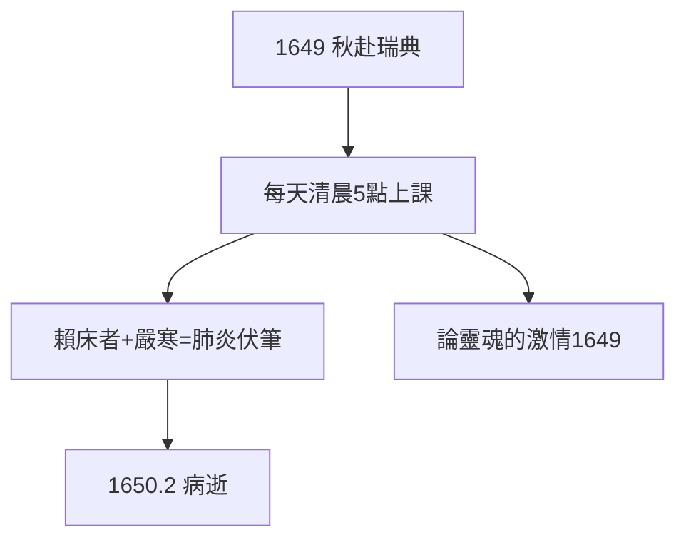

# 5.1 克里斯蒂娜女王（1649）

## 1649 年秋：北上邀請

瑞典女王克里斯蒂娜（22 歲，學霸，不婚主義者）邀請笛卡兒赴斯德哥爾摩任教。笛卡兒猶豫半年（怕冷、怕早起、怕宮廷），最終因女王的誠意 + 法國大使的勸說成行——**這是他人生最後悔的決定**（如果他能後悔的話）。

## 清晨五點的哲學課

女王要求每天清晨 5 點上課（她 5 點起床）。笛卡兒一生賴床（1.1），在零下二十度的斯德哥爾摩，披衣穿過寒風去宮殿講哲學——給一個 22 歲女孩講《哲學原理》，她更關心愛情與政治。

## 雞同鴨講的隱喻

他給女王講「身心交互」（松果腺），女王問：「激情如何服從理性？」——哲學家與女王的對話，雞同鴨講。五個月的課程，產出《論靈魂的激情》（1649）——他最後的著作，寫給女王的教材。

**因果**：《原理》的名聲（4.3）招來女王，女王的作息要了他的命。1.1 的賴床習慣，在斯德哥爾摩的寒冬裡結算。下一節，死亡。
