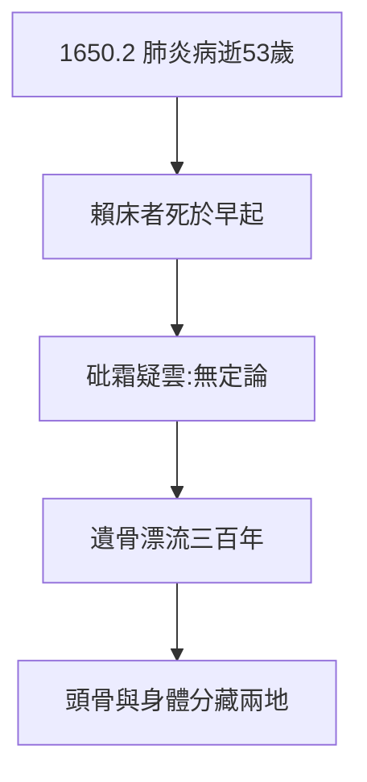

# 5.2 1650 肺炎之死（1650）

## 1650 年 2 月 11 日：斯德哥爾摩

笛卡兒感染肺炎（清晨寒風 + 過勞），延醫十日不治，享年 53 歲。臨終據說用法語說：「我的靈魂，離開的時候到了。」（Ça mon âme, il faut partir.）——我思的終點，是我逝。

## 砒霜疑雲

2010 年，德國學者提出：他可能是被天主教傳教士毒死（怕他影響女王改宗新教）——骨骼檢測無定論。主流仍認肺炎：**賴床者死於早起**，是最簡潔的解釋（1.1 的伏筆兌現）。

## 遺骨漂流

- 1666 年遺骨運回巴黎，葬聖日耳曼；
- 大革命期間遷葬先賢祠，又遷出；
- 頭骨據說被瑞典人留下，今藏巴黎人類博物館——身首異處三百年。

**因果**：1.1 的賴床 → 5.1 的早課 → 本節的肺炎。一生的習慣，一死的病因——哲學家的死，像他的哲學一樣「身心交互」：身體敗給了寒冷，心靈敗給了女王。下一節，蓋棺。
