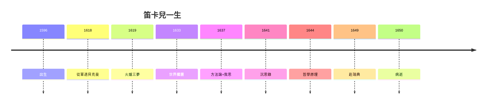

# 5.3 身心二元與現代性（1650–2020）

## 笛卡兒的遺產清單

| 領域 | 遺產 | 命運 |
|---|---|---|
| 數學 | 解析幾何 | 永生，教科書第一章 |
| 方法 | 普遍懷疑四規則 | 科學精神的自我意識 |
| 哲學 | 我思、身心二元 | 三百年爭論，至今未熄 |
| 物理 | 渦旋說、慣性定律 | 渦旋死，慣性活 |
| 語言 | 法文學術寫作 | 法語學術傳統 |

## 身心問題：未解的結

「思考的我」如何推動「廣延的身體」？松果腺的答案無人相信，但問題本身開闢了心靈哲學：偶因論（馬勒伯朗士）、預定和諧（萊布尼茨）、物理主義（當代）——全是笛卡兒問題的注腳。

## 現代性的奠基人

- 主體性：我思 → 啟蒙的自我 → 人權的哲學基礎；
- 機械自然觀：世界是機器 → 工業革命的世界觀；
- 普遍懷疑： Authority 不再豁免 → 科學革命 + 民主革命的共同語法。

**因果閉環**：賴床的孤兒（1.1）→ 耶穌會的數學（1.2）→ 火爐的夢（2.1）→ 解析幾何（2.2、3.2）→ 我思（3.3）→ 沉思原理（4.1、4.3）→ 瑞典的雪（5.1、5.2）。**用懷疑開始，用肺炎結束**——但懷疑永生：每一個說「讓我再想想」的人，都是笛卡兒的學生。
