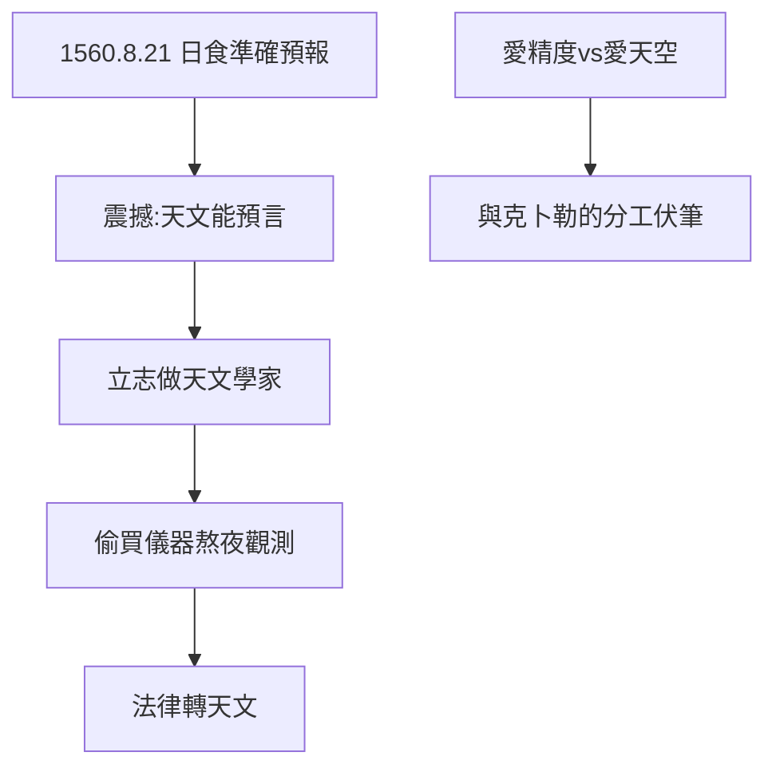

# 1.2 日食之約（1560）

## 1560 年 8 月 21 日：哥本哈根

14 歲的第谷在哥本哈根大學（學法律，家族安排）親歷日食。最震撼他的不是天黑，而是：**日食被準確預報了**——天文學能預言未來！他當場立志：「我要做天文學家。」

## 與克卜勒的對照

- 克卜勒 1577 年看彗星（6 歲，被抱著看）；
- 第谷 1560 年看日食（14 歲，自己懂了）；
- 一個被天文震撼，一個被預報震撼——**一個愛天空，一個愛精度**。這正是兩人後來的分工：克卜勒立法，第谷量天。

## 法律轉天文

家族要他當官，他偷買天文儀器、熬夜觀測。1562 年被送萊比錫繼續讀法律，他卻記錄了木星土星合相——**陽奉陰違的典範**，貴族少年的叛逆。

**因果**：一次被預報的日食，製造了一個精度偏執狂。下一節，決鬥——貴族的另一面。
