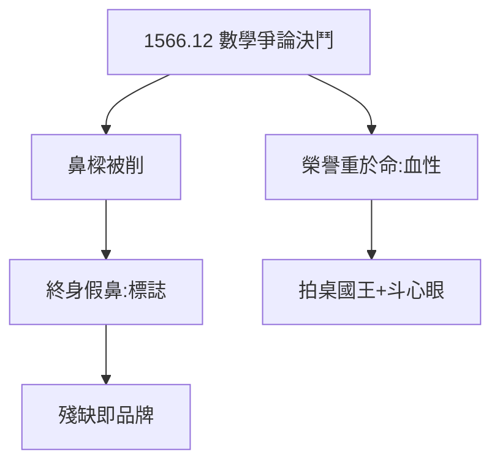

# 1.3 決鬥失鼻（1566）

## 1566 年 12 月 29 日：羅斯托克

20 歲的第谷與貴族同學曼德魯普（Manderup Parsbjerg）爭論數學問題（據說是誰的公式對），拔劍決鬥，被削掉鼻樑。此後終身佩戴假鼻（金銀合金，傳說是金的，實為銅）——肖像畫裡的銀鼻子，成了他的標誌。

## 決鬥的隱喻

- 為數學公式決鬥：書呆子的極致，也是貴族的極致；
- 失去鼻子，得到傳奇：沒有這場決鬥，他只是普通貴族天文愛好者；
- 假鼻的啟示：**殘缺也可以是品牌**——後世記住他，一半因為數據，一半因為鼻子。

## 貴族的血性

這場決鬥說明：他把榮譽看得比命重。這種血性後來用在跟國王拍桌子（3.3）、跟克卜勒斗心眼（4.2）——成也血性，敗也血性。

**因果**：日食的志向（1.2）+ 決鬥的血性 = 第谷的完整人格：為真理可以拼命，為榮譽也可以拼命。下一章，新星——命運的禮物。
