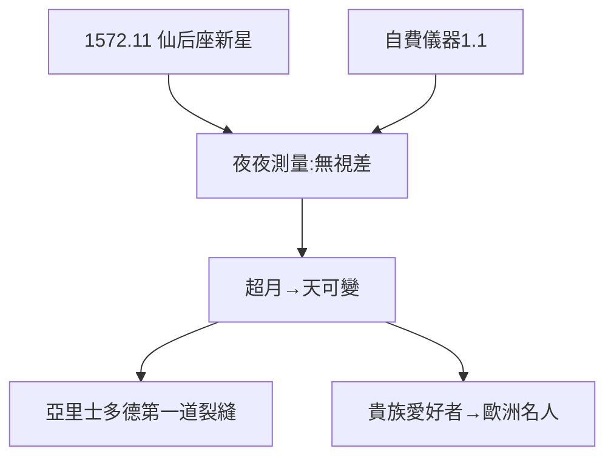

# 2.1 1572 超新星（1572）

## 1572 年 11 月 11 日：仙后座的新星

第谷從實驗室回家，看到仙后座一顆前所未見的亮星（亮如金星，白天可見），持續十六個月漸暗——今天稱為「第谷超新星」（SN 1572，Ia 型）。他夜夜測量，證明它**沒有視差**：在月亮之外，在恆星天上。

## 亞里士多德的崩塌

- 傳統：月上世界永恆不變，新天體只能在大氣層（彗星）；
- 第谷：無視差 → 超月 → 天可變；
- 34 年前哥白尼出版《天體運行論》（1543），32 年後克卜勒出生（1571）——1572 年卡在中間，是舊宇宙觀的第一道裂縫。

## 機遇與準備

別人也看到了新星，只有第谷測了視差——**機遇偏愛有儀器的人**（他自費的儀器，1.1 的遺產）。一顆星，把他從貴族愛好者變成歐洲名人。

**因果**：遺產買的儀器（1.1）+ 日食立的志向（1.2）= 抓住超新星。一顆星改變一生——下一節，寫書。
