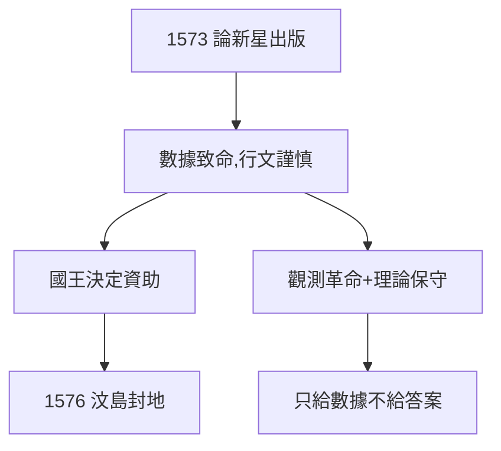

# 2.2 論新星（1573）

## 《論新星》（De Nova Stella，1573）

第谷出版觀測報告：新星的位置、亮度變化、無視差證明。行文謹慎（不敢直接否定亞里士多德），數據卻致命——同行一看就懂：天變了。

## 一書成名的連鎖

- 丹麥國王腓特烈二世讀後，決定資助他（見 2.3）；
- 歐洲天文學家來信結交，包括後來的論敵；
- 「第谷」從名字變成品牌：精度、貴族、自費——天文學的奢侈品。

## 謹慎的革命者

他終身不敢接受哥白尼（4.3 的第谷體系是妥協），卻用數據親手埋葬亞里士多德。**觀測上革命，理論上保守**——這是他的全部矛盾，也是他的全部價值：只給數據，不給答案（答案留給克卜勒）。

**因果**：超新星（2.1）寫成書，書換來島。從自費（1.1）到國費——第谷的事業升級。下一節，汶島。
