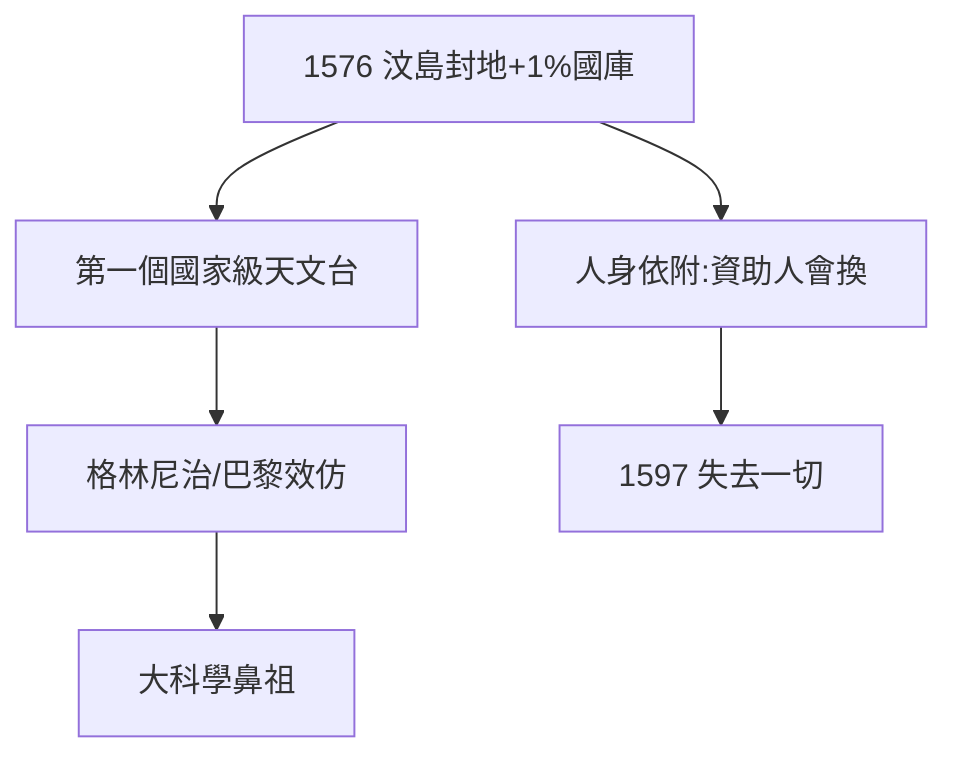

# 2.3 汶島封地（1576）

## 1576：國王的禮物

腓特烈二世把汶島（Hven）封給第谷，年俸 + 關稅，年收入約 1% 國庫——人類歷史上第一個國家級天文台項目。第谷本想去德國當教授（巴塞爾），國王用島把他留下。

## 國家級項目的誕生

- 此前天文學是個人愛好（托勒密、哥白尼都是業餘）；
- 此後天文學是國家事業：格林尼治（1675）、巴黎（1667）都學汶島；
- **大科學的鼻祖**：國家出錢，學者出數據，天下共享（理論上）。

## 島的代價

封地意味著人身依附：國王死（1588），新王不待見（3.3），島就收回。國家項目最大的風險，是資助人會換——第谷 1597 年失去一切，根子在 1576 年的封地性質。

**因果**：《論新星》（2.2）換來島，島換來二十年數據（第 3 章），也換來二十年後的流亡（3.3）。國家項目是蜜糖，也是枷鎖。下一章，烏拉尼堡。
