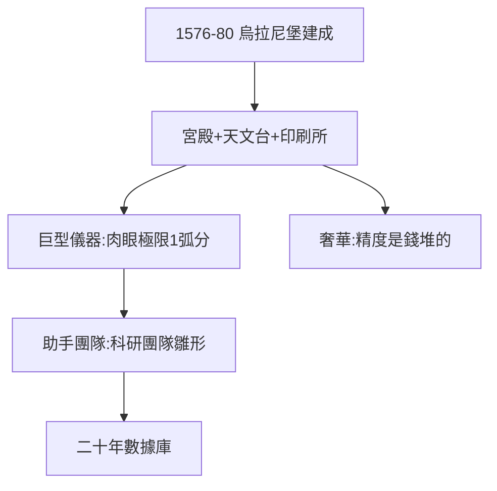

# 3.1 天堡（1576–1580）

## 烏拉尼堡（Uraniborg）：天堂之城

1576–80 年，第谷在汶島建成烏拉尼堡：宮殿 + 天文台 + 印刷所 + 造紙坊 + 實驗室——文藝復興的科研綜合體。地下還有「星堡」（Stjerneborg），儀器固定在基岩上，防震動。

## 儀器的藝術

- 四分儀、渾儀，半徑數米，刻度精到弧分；
- 不用望遠鏡（1608 年才發明），全靠肉眼 + 巨型儀器——人類肉眼觀測的極限（1 弧分）；
- 助手團隊：分工觀測、記錄、計算——近代科研團隊的雛形。

## 奢華的科學

島上養孔雀、釀酒、馴鹿拉車（送給皇帝的禮物），第谷的生活是國王級的。批評者說他揮霍，支持者說：**精度是錢堆出來的**——1 弧分，就是 1% 國庫的形狀。

**因果**：封地（2.3）變成天堡，天堡產出數據。1576–97 的汶島二十年，是人類肉眼天文的珠峰——下一節，數據。
