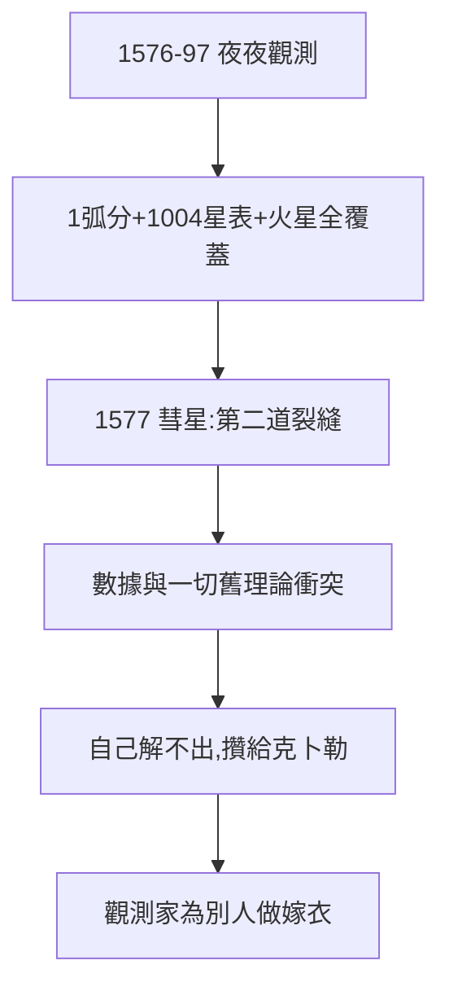

# 3.2 二十年觀測（1576–1597）

## 1576–1597：人類最精確的眼睛

二十年間，第谷團隊夜夜觀測：太陽、月亮、行星、恆星（1004 顆星表），精度 1 弧分（此前最好 10 弧分）。火星數據連續覆蓋多個會合週期——正是克卜勒需要的（《克卜勒傳》3.2）。

## 1577 彗星：第二個釘子

1577 年大彗星（克卜勒 6 歲看的那顆），第谷測出視差小於月亮——彗星也在超月，天體可穿行「水晶天球」。亞里士多德的第二道裂縫（第一道是 1572 新星，2.1）。

## 數據的詛咒

- 數據越精確，越與所有舊理論衝突（托勒密、哥白尼都對不上）；
- 第谷自己解不出來，只能攢著——攢給克卜勒（4.2）；
- **觀測家的宿命：為別人做嫁衣**（5.3 詳述）。

**因果**：天堡（3.1）產出數據，數據殺死舊理論，卻生不出新理論——因為新理論需要數學家（克卜勒），而數學家在 1597 年還沒來。先來的，是國王的敵意（下一節）。
