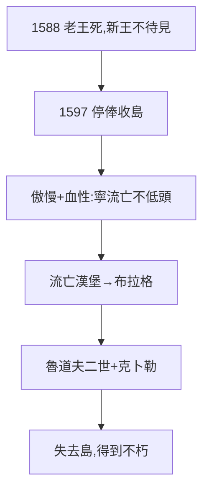

# 3.3 與丹麥宮廷決裂（1597）

## 1588–1597：新王不待見

腓特烈二世 1588 年去世，幼主克里斯蒂安四世（11 歲）繼位，攝政貴族看第谷不順眼：花錢太多、脾氣太臭（毆打佃農被告狀）、不務正業（占星多於「正事」）。1597 年，國王停發年俸、收回汶島——第谷帶著儀器、數據、家人流亡。

## 傲慢的代價

- 1.1 的貴族傲慢：跟佃農打架、跟大臣拍桌；
- 1.3 的血性：寧可流亡，不低頭；
- 汶島的教訓（2.3）：國家項目的命，繫於資助人一身——資助人換了，命就沒了。

## 因禍得福

流亡 → 漢堡 → 布拉格 → 魯道夫二世（4.1）→ 克卜勒來投（4.2）。如果一直在汶島，數據永遠是第谷的；正因為流亡，數據才流向克卜勒——**失去島，得到不朽**（5.3）。

**因果**：封地的枷鎖（2.3）+ 傲慢的性格（1.1、1.3）= 流亡。而流亡是歷史的安排：數據必須離開島，才能遇到數學家。下一章，布拉格。
