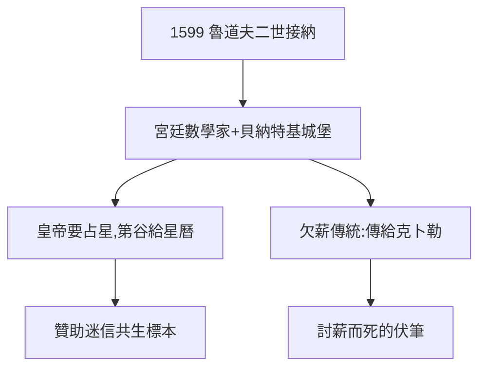

# 4.1 魯道夫二世（1599）

## 1599：布拉格的怪皇帝

神聖羅馬帝國皇帝魯道夫二世（藝術贊助人、占星愛好者、精神不穩定）接納流亡的第谷，封為宮廷數學家，年薪 3000 弗羅林（從未足額發放）。貝納特基城堡成為第二個汶島——小得多，短得多。

## 皇帝的交換

- 皇帝要：占星預言（戰爭、健康、繼承人）；
- 第谷給：星曆 + 天文台門面；
- 各取所需：科學史上「贊助—迷信」共生關係的標本（克卜勒與華倫斯坦是下一個，見《克卜勒傳》5.1）。

## 欠薪的傳統

3000 弗羅林多數沒兌現——宮廷欠薪從第谷傳到克卜勒（《克卜勒傳》5.2 討薪而死）。**為王室打工，欠薪是福利的一部分**。

**因果**：流亡（3.3）→ 布拉格 → 第二個天文台。舞台雖小，關鍵人物到齊：皇帝出錢（欠著），第谷出數據，克卜勒（下一節）出數學。三缺一的最後一塊，即將登場。
