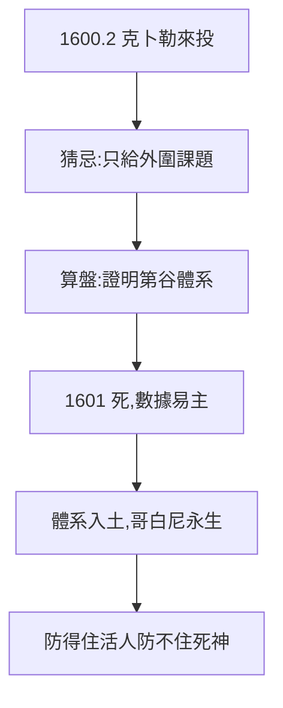

# 4.2 克卜勒來投（1600）

## 1600 年 2 月：相會（詳見《克卜勒傳》2.3）

失業的克卜勒來投，合作從猜忌開始：第谷怕他搶數據、搶功名，只給外圍課題；克卜勒想要火星核心數據。兩個天才的磨合，像兩隻刺蝟取暖。

## 第谷的算盤

- 要克卜勒證明**第谷體系**（4.3），不是哥白尼；
- 要他的數學筆，怕他的日心心；
- 臨終遺言「證明我的體系」（《克卜勒傳》3.1）——算盤打到死。

## 算盤的落空

1601 年 10 月第谷死，數據全歸克卜勒。防了一年，功虧一簣——**防得住活人，防不住死神**。第谷體系隨他入土，哥白尼借他的數據永生。

**因果**：決裂流亡（3.3）→ 布拉格（4.1）→ 克卜勒。一年猜忌，一朝易主——第谷用生命守住的數據，用死亡交了出去。下一節，他守的是什麼體系。
